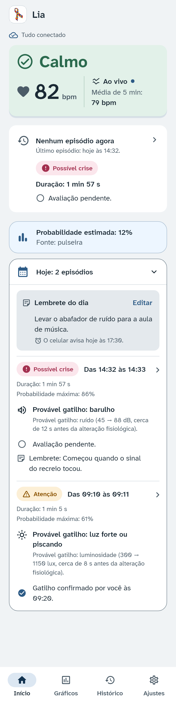
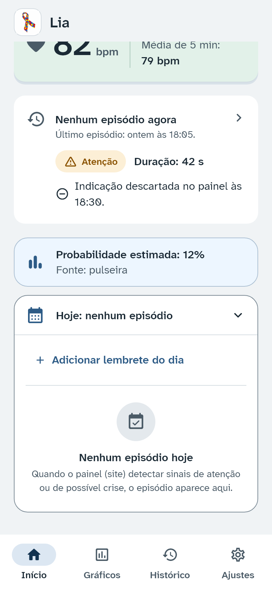
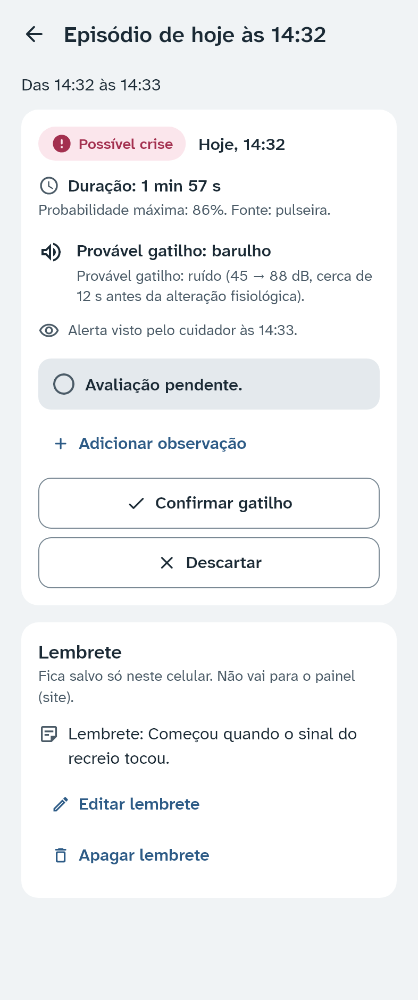
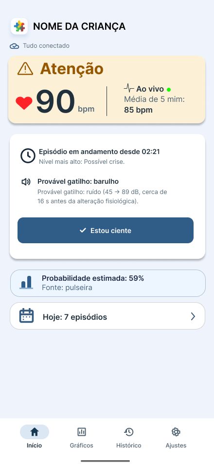
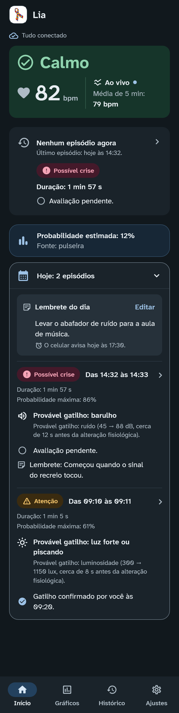
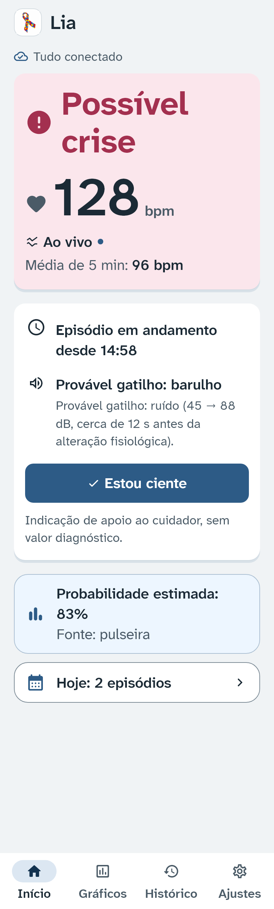
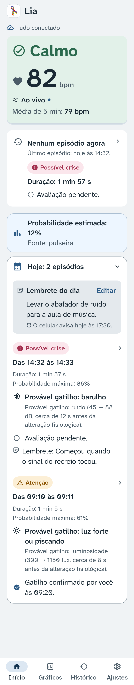

# Design do app do cuidador (UX/UI)

Este documento descreve o redesenho visual do app do cuidador (`mobile/`): a
direção visual, a paleta com os contrastes medidos, a tipografia, as decisões
de acessibilidade pensadas para o público do TEA e o antes e depois de cada
tela. A lógica do app (MQTT, notificações, formatos de mensagem) não mudou; o
funcionamento está em [app.md](app.md).

## 1. Público e tarefa principal

Quem usa o app são pais, cuidadores e profissionais de crianças com TEA.
Muitas vezes estão cansados, sob estresse, com a atenção dividida e olham o
celular por poucos segundos. A pergunta que o app precisa responder nesse
tempo é uma só: **"preciso agir agora?"**. Disso saem três requisitos:

1. O estado da criança (Calmo / Atenção / Possível crise) tem que ser
   entendido em menos de 2 segundos, sem depender de ler texto pequeno nem de
   distinguir cores.
2. Quando há um episódio, a ação ("Estou ciente") e a pista de causa (o
   provável gatilho) ficam juntas do estado, em linguagem simples.
3. A interface não pode aumentar a carga do cuidador: nada piscando, nada
   pulsando, nenhuma cor alarmante quando está tudo bem.

## 2. Direção visual: "Sala calma"

A referência vem dos **ambientes de baixa estimulação** usados no TEA (salas
de regulação sensorial): cores pouco saturadas, superfícies foscas, sem
brilhos, e cor apenas onde ela carrega significado. A única sombra do app é
suave e azulada, só nas duas peças "ao vivo" da tela Início e só no tema
claro (seção 5). A interface
fica quieta quando está tudo bem e é inconfundível quando não está.

Três princípios guiam todas as telas:

- **Um elemento principal.** A *faixa de estado* da tela Início é um bloco
  largo, tingido pela cor do nível. Todo o resto do app é discreto. Na versão
  feita a partir do modelo do Figma (seção 7.1), a faixa e o cartão do
  episódio em andamento são as únicas peças com sombra: são as peças "ao
  vivo".
- **Vermelho e amarelo são reservados para o risco.** A fita do logo é
  vermelha, amarela e azul, e o vermelho e o amarelo são justamente as cores
  de Atenção e Possível crise. Por isso o logo mantém as suas cores, mas a
  interface nunca usa vermelho ou amarelo como decoração, nem em botões como
  "Descartar" ou "Sair" (no visual anterior os dois eram vermelhos). A cor de
  ação vem do azul da fita, dessaturado.
- **Cada texto faz um trabalho.** Títulos em caixa normal (a única caixa alta
  é o logotipo "PUZZLE BAND", que é identidade), frases curtas em voz ativa e
  mensagens de erro que dizem o que aconteceu e o que fazer.

O primeiro rascunho seguia o padrão de app de saúde (um BPM grande com um
coração e uma pilha de cartões brancos com sombra). Ele foi trocado porque a
decisão do cuidador depende do **nível**, não do número: na faixa, a manchete
é o nome do nível, e o BPM vem logo abaixo.

## 3. Paleta

Todos os pares de texto foram medidos com a fórmula de contraste do WCAG 2.1
(critério 1.4.3, mínimo de 4,5:1 para texto normal). Contornos de campos e
marcas de gráfico seguem o critério 1.4.11 (mínimo de 3:1).

### Base

| Papel | Claro | Escuro | Contraste (claro / escuro) |
|---|---|---|---|
| Fundo ("névoa") | `#F0F3F5` | `#11181D` | — |
| Superfície (cartões) | `#FFFFFF` | `#1A232A` | — |
| Superfície de destaque neutro | `#E4E9ED` | `#26313A` | — |
| Texto principal | `#1B2A35` | `#E8EEF2` | 14,7 / 13,6 sobre a superfície |
| Texto secundário | `#4B5B67` | `#AEBBC5` | 7,0 / 8,1 sobre a superfície; 5,7 / 6,8 sobre o destaque |
| Ação (azul ardósia da fita) | `#2D5B86` | `#9DC2E6` | texto do botão 7,1 / 7,9 |
| Contorno (campos, controles) | `#7A8994` | `#6B7A86` | 3,6 / 3,6 sobre a superfície; 3,2 / 4,1 sobre o fundo (mínimo de 3:1) |
| Divisórias e grade (decorativas) | `#D6DDE2` | `#2E3A44` | — |
| Linha informativa (probabilidade) | `#EDF6FF` | `#172736` | texto 13,5 / 13,0; secundário 6,4 / 7,8; ícone 6,5 / 8,2 |
| Borda da linha informativa (decorativa) | `#ABBFD2` | `#34506A` | 1,7 / 2,1 sobre o fundo (não é controle) |
| Sombra das peças "ao vivo" | `#2D5B86` a 6% (1 dp, desfoque 3) + 12% (4 dp, desfoque 16) | nenhuma | — |

### Níveis de risco

| Nível | Texto e ícone | Fundo tingido | Gráfico | Texto sobre o fundo tingido | Gráfico sobre a superfície |
|---|---|---|---|---|---|
| Calmo | `#2B6A4E` | `#E2F1E9` | `#2B9066` | 5,5 | 4,0 |
| Atenção | `#8A5200` | `#FCEFD6` | `#C08A00` | 5,6 | 3,1 |
| Possível crise | `#A3304F` | `#FBE6EC` | `#C73E66` | 5,7 | 4,3 |
| Sem dados | `#56636D` | `#E6EBEE` | — | 5,1 | — |

No tema escuro, os níveis usam `#8FD3AE`, `#F3C46B`, `#F5A3B6` e `#A7B3BC`
sobre fundos tingidos escuros (`#16352A`, `#3A2B10`, `#44192A`, `#263038`),
com contrastes entre 6,3 e 8,4. O texto principal sobre qualquer fundo
tingido fica acima de 11:1 nos dois temas.

- **O vermelho de "Possível crise"** é um framboesa profundo (`#A3304F`)
  sobre um rosado claro, no lugar do vermelho de alarme (`#E53935`). Ele chama
  atenção pela área tingida, pelo tamanho e pelo ícone, não pela saturação.
- **As cores dos gráficos** foram validadas para daltonismo (protanopia,
  deuteranopia e tritanopia) com o validador da skill de visualização de
  dados: separação mínima entre cores vizinhas ΔE ≥ 8 nos dois temas, todas
  com contraste ≥ 3:1 contra a superfície. A primeira tentativa (verde-sálvia,
  âmbar e vermelho mais próximos) falhou nessa checagem e foi ajustada.

## 4. Tipografia

- **Fonte: Atkinson Hyperlegible Next** (Braille Institute of America,
  licença SIL OFL 1.1), desenhada para leitores com baixa visão. Ela
  diferencia bem os caracteres que se confundem (1/l/I, 0/O, 8/B), o que
  importa para BPM e horários lidos às pressas. O zero cortado (0 com barra) é
  um recurso dela para não confundir 0 com O. Os pesos 400, 500, 600 e 700
  estão empacotados em `mobile/assets/fonts/`, com a licença: o app não
  depende de internet para a fonte.
- **Escala** (a escala clássica de *The Elements of Typographic Style*, em
  sp):

  | Tamanho | Peso | Uso |
  |---|---|---|
  | 60 | 600 | BPM ao vivo (o modelo do Figma usa 64; 60 é o degrau da escala) |
  | 48 | 600 | BPM ao vivo quando as duas colunas da faixa não cabem com 60 |
  | 36 | 700 | Nome do nível na faixa |
  | 24 | 700 | Título de tela |
  | 18 | 600 | Título de seção |
  | 16 | 400 | Corpo (maior que os 14 sp padrão do Material 3) |
  | 14 | 400 | Texto secundário, o menor tamanho de leitura |
  | 12 | 500 | Só nos eixos dos gráficos |

- **Glifos ausentes.** A fonte não tem a seta "→" que aparece no texto do
  gatilho enviado pelo site ("45 → 88 dB"). O tema declara a fonte do sistema
  como fallback; no Android a seta vem da fonte de símbolos do sistema.

## 5. Forma, espaçamento e movimento

- **Raios em hierarquia**, em vez de um raio único em tudo (medidas do
  modelo do Figma): 20 dp nas linhas da tela Início (probabilidade e botão
  "Hoje"), 16 dp na faixa de estado, nas seções e nos cartões, 12 dp em
  botões e campos, e formato de pílula nos selos de nível. O logo grande do
  Login mantém 28 dp.
- **Sombra só onde há algo ao vivo.** A faixa de estado e o cartão do
  episódio em andamento têm uma sombra suave e azulada, tirada do azul de
  ação, no lugar da sombra preta a 25% do modelo. O tema escuro não tem
  sombra: ali as peças se separam pelo tom. O resto do app continua sem
  sombra, e a barra de navegação tem uma linha de 1 dp.
- **Espaçamento** em múltiplos de 4 dp (4, 8, 12, 16, 24, 32), com margem de
  tela de 20 dp e largura máxima de conteúdo de 560 dp (tablet ou celular
  deitado).
- **Movimento só como resposta a uma mudança**, sempre curto (200 a 400 ms):
  - a cor da faixa transita quando o nível muda;
  - o bloco do episódio entra com transição de tamanho;
  - "Confirmar gatilho" e "Descartar" viram uma linha de confirmação com
    fade;
  - "Estou ciente" vira "Ciente às HH:MM" com fade; a confirmação some
    sozinha depois de 5 s, com outro fade de 200 ms;
  - o painel "Hoje" abre e fecha com transição de tamanho, e a seta gira de
    ">" para "⌄";
  - um único fade na abertura do Login.
- **Sem movimento:** nada se move sozinho. O coração e o ponto de estado que
  pulsavam sem parar no visual anterior (900 ms, escala de 0,95 a 1,2) foram
  removidos. O BPM troca de valor sem animar, e o gráfico ao vivo não anima a
  cada ponto.
- **Reduzir movimento.** Com "Remover animações" ligado no Android
  (`MediaQuery.disableAnimations`), todas as durações viram zero, inclusive a
  transição entre telas.

## 6. Decisões de acessibilidade para o público do TEA

| Decisão | Por quê | Como foi verificado |
|---|---|---|
| Nível sempre com ícone + palavra + cor; ícones de formatos diferentes (círculo com ✓, triângulo, círculo cheio com !) | Cor nunca sozinha (WCAG 1.4.1), daltonismo, leitura rápida sob estresse | Teste de widget confere ícone e texto de cada nível |
| Contraste AA em todo texto, nos dois temas | Cansaço, sol no celular, baixa visão | `textContrastGuideline` do Flutter em todas as telas, claro e escuro |
| Alvos de toque ≥ 48 × 48 dp; "Estou ciente" com 56 dp e largura total | Mão ocupada, pressa, tremor (WCAG 2.5.5) | `androidTapTargetGuideline` em todas as telas; teste da altura do botão |
| Funciona com a fonte do sistema ampliada até 1,3× | Leitores com baixa visão aumentam a fonte do sistema (WCAG 1.4.4) | Todas as telas em 8 estados com fonte 1,3×: nenhum texto cortado ou sobreposto |
| Leitor de tela: estado, BPM, gatilho e botões com rótulo; **só o nível é anunciado automaticamente**, e só quando muda | O BPM muda 1×/s: se fosse anunciado a cada mudança, o TalkBack falaria um número por segundo | Teste confere os rótulos e que o BPM não é região ao vivo; `labeledTapTargetGuideline` |
| Nada pisca nem pulsa; animações curtas e só como resposta | Sensibilidade sensorial e carga de atenção (WCAG 2.3.3) | Teste: a tela Início "assenta" sem animação em loop; com "reduzir movimento", as durações são zero |
| Vermelho de crise firme, mas não agressivo; vermelho e amarelo só para risco | Alarme visual aumenta o estresse; cor com significado único é aprendida mais rápido | Paleta acima |
| Gatilho em linguagem simples ("Provável gatilho: barulho"), com o texto técnico do site logo abaixo | O cuidador decide rápido ("baixar o som"); o texto técnico continua disponível. A manchete sempre diz "provável": a regra não afirma causa | Teste das manchetes para cada `tipo` de gatilho |
| Cada falha diz o que aconteceu e o que fazer (conectando, sem conexão, painel parado, pulseira desconectada, configuração incompleta) | Estado ambíguo ("—" sem explicação) gera ansiedade | Testes e imagens de cada estado |
| Tema escuro seguindo o sistema | O cuidador olha o celular à noite, muitas vezes no quarto da criança: menos brilho e menos luz no ambiente | Imagens no tema escuro; contraste AA verificado |
| Navegação com rótulos sempre visíveis; nome da aba igual ao título da tela | Ícone sozinho exige memorização | Teste confere "Ajustes" na aba e no título |
| Painel "Hoje": o botão informa ao leitor de tela se está aberto ou recolhido; cada episódio é um botão que fala o relatório inteiro | O cuidador sabe o que o toque faz e ouve o episódio sem abrir o detalhe | Teste do estado expandido (`isExpanded`) e dos rótulos; `labeledTapTargetGuideline` com o painel aberto |
| A confirmação do "Estou ciente" é anunciada uma vez e some sozinha depois de 5 s; o botão não volta para o mesmo episódio | A mensagem não fica velha na tela, e o cuidador não precisa fechar nada | Teste com `tester.pump(Duration(seconds: 5))`; teste de que o timer é cancelado ao sair da tela |
| Botão "Hoje" com contorno de 3,2:1 sobre o fundo (o modelo tinha 1,4:1) | É um controle (WCAG 1.4.11) | Contraste medido; `androidTapTargetGuideline` |

## 7. Antes e depois, tela a tela

As imagens do "antes" foram geradas a partir da versão anterior do app (commit
`3dce2b0`), com os mesmos dados de exemplo e o mesmo tamanho de tela
(393 × 852 dp). As do "depois" são as imagens dos testes golden em
`mobile/test/goldens/`.

### Início

| Antes | Depois |
|---|---|
|  |  |

- **Antes:**
  - o título "TELA INICIAL" não acrescentava informação;
  - três chips técnicos ficavam sempre visíveis ("Broker: conectado");
  - o nível aparecia duas vezes (no card de alerta e no "Estado Atual"), e o BPM ficava num terceiro card, mais abaixo;
  - o botão "Estou ciente" era vermelho, e o ponto e o coração pulsavam sem parar;
  - textos cinza em 2,7:1.
- **Depois:**
  - o cabeçalho mostra o nome da criança;
  - a faixa de estado mostra o nível (ícone + palavra) e o BPM, com "Ao vivo" e a média de 5 min ao lado;
  - logo abaixo, o cartão do episódio em andamento traz o provável gatilho em linguagem simples e o "Estou ciente" em azul, com 56 dp;
  - sem episódio, o cartão diz "Nenhum episódio agora" e resume o último;
  - depois vêm a probabilidade e o botão "Hoje", que abre os episódios do dia;
  - a linha de conexão só aparece quando há algo a dizer.

A primeira versão do redesenho punha tudo dentro da faixa (nível, BPM,
gatilho e botão) e deixava muito espaço vazio abaixo dela. A versão atual
segue o modelo do Figma (seção 7.1).

Estados da tela Início:

| Calmo | Atenção | Logo depois do "Estou ciente" |
|---|---|---|
|  |  |  |

| Painel "Hoje" aberto, com lembretes | Painel "Hoje" sem episódios | Detalhe do episódio |
|---|---|---|
|  |  |  |

| Sem conexão | Painel (site) e pulseira offline | Configuração incompleta (`env.json`) |
|---|---|---|
|  |  |  |

No visual anterior, sem conexão o card mostrava "Sem dados" e perguntava "O
painel (site) está aberto?", mesmo quando o problema era a conexão do
celular; o motivo real ficava num chip ("Broker: desconectado"), em termo
técnico (imagem `imagens/app-antes/inicio_sem_conexao.png`).

### 7.1 Início a partir do modelo do Figma

O modelo está no Figma (arquivo "App Puzzle Bando", frame `1:2`). As medidas,
as cores, os textos e a ordem dos blocos foram anotados em
[figma/home.md](figma/home.md), com a captura em
[figma/home.png](figma/home.png). O código de referência do Figma (web) não
foi copiado: a tela foi reescrita em Flutter com o tema do app, e as cores e
medidas novas entraram no tema.

| Modelo (Figma, 440 × 956) | App (393 × 852 dp) |
|---|---|
|  |  |

**Ordem dos blocos (a mesma do modelo).**

1. Cabeçalho: logo e nome da criança.
2. Linha de conexão ("Tudo conectado").
3. Faixa de estado: nível; embaixo, o BPM à esquerda e, depois de uma
   divisória vertical, "Ao vivo" com um ponto e a média de 5 min.
4. Cartão do episódio: desde quando, o nível mais alto (quando passou do
   atual), o provável gatilho e o "Estou ciente". Sem episódio em andamento,
   o lugar fica com o cartão "Nenhum episódio agora".
5. Linha da probabilidade estimada, com a fonte do dado.
6. Botão "Hoje: X episódios", que abre o painel do dia.

**Decisões.**

- **Nome da criança.** O modelo mostra "NOME DA CRIANÇA" no lugar do
  logotipo. O nome é digitado em Ajustes, fica só no celular e aparece em
  caixa normal. Sem nome, o cabeçalho mostra o `CHILD_ID`. As outras telas
  continuam com "PUZZLE BAND".
- **BPM em duas colunas, sem cortar.** O modelo cabe numa tela de 440 dp com
  um BPM de dois dígitos ("90"). Com três dígitos, que é o caso de uma crise,
  e num celular de 393 dp, as duas colunas não cabem com o número em 60 sp.
  A faixa escolhe sozinha o maior tamanho que deixa as colunas lado a lado:
  60 sp a partir de ~410 dp e 48 sp em 393 dp. Se nenhum cabe (celular
  estreito ou fonte ampliada), "Ao vivo" e a média descem para uma linha
  abaixo do BPM. A medida usa sempre "888", para a disposição não mudar
  quando o BPM passa de 99 para 100.
- **Estado Calmo.** O modelo só mostra o caso Atenção com episódio. No Calmo,
  o lugar do cartão do episódio mostra "Nenhum episódio agora" e o último
  episódio real do histórico: nível, quando, duração e avaliação. Tocar abre
  o detalhe. Nenhum dado é inventado: sem histórico, o cartão diz "Nenhum
  episódio registrado ainda".
- **Probabilidade numa linha própria**, azulada e com borda clara, como no
  modelo. Ela não é tocável, então a borda é decorativa.

**Painel do dia ("Hoje").**

- Fechado, é um botão compacto com o número de episódios de hoje ("Hoje: 2
  episódios" ou "Hoje: nenhum episódio").
- Ao tocar, abre ali mesmo, com transição de tamanho (nenhuma com "reduzir
  movimento"). Mostra o lembrete do dia e todos os episódios de hoje, do mais
  recente para o mais antigo.
- Cada episódio traz um relatório:
  - nível máximo (selo com ícone e palavra);
  - "Das 14:32 às 14:33" ou "Desde 14:58, em andamento". Quando o site não
    manda o fim, ele é o início mais a duração;
  - duração e probabilidade máxima;
  - provável gatilho em linguagem simples, com o texto técnico do site
    embaixo;
  - avaliação (pendente, confirmada ou descartada);
  - o lembrete do episódio, se houver.
- Tocar num episódio abre o detalhe. Ele usa o mesmo cartão do Histórico,
  com "Confirmar gatilho" e "Descartar", e mais o lembrete do episódio.
- Sem episódios no dia, o painel mostra um estado vazio, e o lembrete do dia
  continua disponível.
- Tocar de novo no botão recolhe o painel.

**Lembretes.**

- O cuidador pode deixar um lembrete curto (até 120 caracteres) em cada
  episódio e um lembrete geral do dia. Os dois podem ser editados ou
  apagados.
- O do dia fica no painel. O de cada episódio aparece no painel e no
  detalhe.
- Opcionalmente, o lembrete pode ter um horário de aviso, e o celular avisa
  com uma notificação local (canal "Lembretes").
  - O agendamento é inexato: pode atrasar alguns minutos, mas não pede a
    permissão de "alarme exato".
  - Na tela bloqueada com PIN, padrão ou digital, o Android não mostra nada
    do lembrete.
  - O serviço de notificação dos alertas não mudou.
- **Decisão de privacidade.** Os lembretes e o nome da criança ficam só no
  `shared_preferences` do celular.
  - Não são publicados no MQTT: não há tópico nem campo novo.
  - Não aparecem no site e não vão para outro aparelho.
  - Motivo: são anotações pessoais do cuidador sobre a criança, e o broker é
    compartilhado com o site, com uma credencial que fica dentro do APK (ver
    "Limitações" em [app.md](app.md)).
  - Consequência: limpar os dados do app, desinstalar ou trocar de celular
    apaga os lembretes, e outro cuidador não vê os lembretes deste.

**"Estou ciente".**

- O toque publica o ack, como antes, e mostra "Ciente às 14:32" (o horário
  do toque). O leitor de tela anuncia "Aviso enviado. Ciente às 14:32."
- Depois de 5 s, a confirmação some com um fade curto (nenhum com "reduzir
  movimento"), e o botão não volta para o mesmo episódio, que já foi
  reconhecido. Num episódio novo, o botão aparece de novo.
- O horário continua no histórico do episódio ("Alerta visto pelo cuidador
  às HH:MM").
- A confirmação usa o azul de ação, não o verde de Calmo, porque a criança
  pode estar em crise.
- O `Timer` de 5 s é cancelado no `dispose`, e o `setState` só roda com a
  tela montada. Um teste falha se o timer ficar pendente ao sair da tela.

**Diferenças que sobraram em relação ao modelo, e por quê.**

| No modelo | No app | Por quê |
|---|---|---|
| Fonte Inter | Atkinson Hyperlegible Next | Fonte aprovada no redesenho (baixa visão, 0/O e 1/l distintos). Ela é mais larga e mais alta, então os blocos ficam um pouco mais altos. |
| Textos de 12,5 e 14 px; rótulos da navegação em 12 | Mínimo de 14 sp para leitura (16 sp nos títulos dos blocos); navegação em 14 | Menor tamanho de leitura definido no tema |
| BPM em 64 | 60 sp em telas de ~410 dp ou mais; 48 sp em 393 dp; empilhado com a fonte ampliada | O BPM de três dígitos não cabe em duas colunas num celular de 393 dp |
| Coração vermelho; ponto "ao vivo" verde | Coração neutro; ponto azul (a cor de "conectado") | Vermelho e verde são cores de nível (Possível crise e Calmo) |
| Borda do "Hoje" em 1,4:1 | Contorno de 3,2:1 | É um controle (WCAG 1.4.11) |
| Sombra preta a 25% | Sombra azulada suave, só na faixa e no cartão do episódio, sem sombra no escuro | Decisão aprovada: menos peso visual, e a sombra marca as peças "ao vivo" |
| Botão "Estou ciente" com 53 px e texto de 14 | 56 dp e 16 sp | Ação principal (área de toque de 56 dp) |
| Raio de 15; espaços de 22 e 11 | Raio de 16; espaços de 20 e 12 | Escala de 4 dp do tema |
| Logo de 35 px com sombra | Selo de 40 dp com borda, sem sombra | O selo do redesenho funciona nos dois temas; sombra só nas peças "ao vivo" |
| Sem a frase "sem valor diagnóstico" | A frase fica embaixo do "Estou ciente" | Aviso ético do projeto |
| "Média de 5 mim:" | "Média de 5 min:" | Erro de digitação |
| Ícones do Figma | Ícones do Material (relógio, alto-falante, barras, calendário, linha de ECG) | Os SVGs do Figma são temporários, e o app já usa os ícones do Material |
| 182 px vazios abaixo do "Hoje" | Calmo: o cartão "Nenhum episódio agora" ocupa o lugar do cartão do episódio; Atenção e crise: o conteúdo chega à barra de navegação; com o painel aberto, a tela rola | Preencher a tela com dados reais |

### Login

| Antes | Depois |
|---|---|
|  |  |

- **Antes:**
  - o botão "Entrar" era cinza com texto branco (1,9:1) e parecia desativado;
  - os campos só tinham texto de exemplo, que some ao digitar.
- **Depois:**
  - o botão "Entrar" é azul (7,1:1) e tem 56 dp;
  - os campos têm rótulo fixo;
  - o aviso diz o que acontece: "qualquer usuário e senha entram";
  - o logo aparece num selo, com a fita maior.

### Gráficos

| Antes | Depois |
|---|---|
|  |  |

- **Antes:**
  - duas caixas com número grande e rótulos em caixa alta;
  - grade tracejada;
  - barra amarela de Atenção com 1,7:1 sobre o fundo;
  - legenda com "Calmo", que nunca aparece numa barra, porque todo episódio começa em Atenção.
- **Depois:**
  - o BPM ao vivo vem primeiro, com eixo rotulado em "bpm", marcas a cada minuto e o valor mais recente no fim da linha;
  - o gráfico de 7 dias tem barras finas nas cores validadas, o valor na ponta de cada barra, "Hoje" no último dia, e só Atenção e Possível crise na legenda;
  - uma frase-resumo substitui as caixas ("4 episódios nos últimos 7 dias, 2 de possível crise. Em novembro: 4 episódios.");
  - cada gráfico tem uma descrição completa para leitor de tela.

### Histórico

| Antes | Depois |
|---|---|
|  |  |

- **Antes:**
  - os detalhes vinham numa linha cinza com pontos ("Duração · Prob. · Pulseira");
  - a avaliação aparecia em cinza claro;
  - o campo de observação ficava sempre aberto em todo cartão;
  - "Descartar" era vermelho;
  - com a fonte em 1,3×, "Confirmar gatilho" ficava espremido contra a borda do botão (imagem `imagens/app-antes/fonte_130_historico.png`).
- **Depois:**
  - cada cartão mostra o selo do nível, a data relativa ("Hoje, 14:32", "Ontem, 18:05"), a duração em destaque e o gatilho em linguagem simples;
  - a avaliação fica numa linha destacada ("Gatilho confirmado por você às 09:20.");
  - a observação fica atrás de "Adicionar observação";
  - os botões têm o mesmo peso visual e ficam um embaixo do outro quando os rótulos não cabem inteiros lado a lado;
  - depois de enviar, o botão escolhido fica cheio com ✓, a linha de avaliação muda com um fade e aparece um aviso com o mesmo verbo do botão ("Gatilho confirmado e enviado ao painel.").

| Lista inteira | Depois de confirmar | Vazio |
|---|---|---|
|  |  |  |

### Ajustes (antes "Configurações", aba "Perfil")

| Antes | Depois |
|---|---|
|  |  |

- **Antes:**
  - uma foto de perfil com ícone de câmera sugeria uma função que não existia;
  - "Privacidade" e "Ajuda e Suporte" tinham seta, mas não abriam nada;
  - "ALERTAS SONOROS" vinha em caixa alta;
  - "Sair da Conta" era vermelho.
- **Depois:**
  - o nome é o mesmo na aba e no título;
  - os grupos são Criança monitorada, Conexões, Alertas e Sobre;
  - cada conexão diz o que significa e mostra o erro, quando houver;
  - "Alertas sonoros" ocupa a linha inteira como área de toque;
  - "Licenças de software" abre as licenças, incluindo a da fonte;
  - "Sair" é neutro.

### Tema escuro e fonte ampliada

| Escuro: Início | Escuro: painel "Hoje" | Escuro: Histórico | Fonte 1,3×: Início | Fonte 1,3×: painel "Hoje" | Fonte 1,3×: Histórico |
|---|---|---|---|---|---|
|  |  |  |  |  |  |

## 8. Como foi verificado

- `flutter analyze` sem avisos.
- `flutter test` roda os testes que já existiam (parse das mensagens, resumos
  e regras de notificação) e mais dois arquivos:
  - **`test/telas_test.dart`**: comportamento e acessibilidade. Cobre:
    - os rótulos para leitor de tela e qual nó é anunciado;
    - "Estou ciente" e a avaliação enviados, e os avisos quando não há conexão;
    - a confirmação do "Estou ciente" sumindo depois de 5 s (com e sem
      animação), o botão voltando só num episódio novo e o timer cancelado
      ao sair da tela;
    - o painel "Hoje" abrindo e fechando, os episódios do dia em ordem, o
      estado vazio e o detalhe com "Confirmar gatilho" e "Descartar";
    - os lembretes do dia e do episódio (salvar, mostrar, editar, apagar, o
      aviso agendado e cancelado) e o nome da criança;
    - a faixa em celulares de 360 e 440 dp;
    - todos os estados de conexão;
    - contraste AA, alvos de toque e rótulos em todas as telas, nos dois temas;
    - fonte 1,3× em todas as telas e estados;
    - "reduzir movimento";
    - as manchetes do gatilho.
  - **`test/goldens_test.dart`**: 41 imagens das telas em `mobile/test/goldens/`.
    Uma mudança visual não intencional faz o teste falhar. Depois de uma
    mudança intencional, gere as imagens de novo com
    `flutter test --update-goldens test/goldens_test.dart`.
- **Como os testes rodam:** com as fontes reais, um `MqttService` de teste
  (subclasse que só troca os dados lidos pelas telas) e um aviso de lembrete
  falso (sem o plugin de notificação).
- **O que não mudou:** a lógica de MQTT, as notificações dos alertas, os
  tópicos e os formatos de mensagem. Os arquivos `mqtt_service.dart`,
  `notification_service.dart`, `app_scope.dart`, `lib/models/` e
  `lib/config/` não foram alterados. A tela Início ganhou dois arquivos
  novos em `lib/services/`: `preferencias_locais.dart` (nome e lembretes) e
  `aviso_de_lembrete.dart` (aviso agendado).

## 9. Limitações e ressalvas

- **Símbolo do quebra-cabeça.** O logo (fita de quebra-cabeça) foi mantido
  como identidade do projeto. Vale registrar que parte da comunidade autista
  critica esse símbolo, por associar o autismo a algo "incompleto" ou a um
  "enigma a resolver", e prefere outros, como o infinito arco-íris
  (neurodiversidade). Um estudo com adultos não autistas encontrou
  associações negativas ligadas a peças de quebra-cabeça (Gernsbacher et al.,
  2018). Numa versão de produto, a escolha do símbolo deveria ser feita junto
  com pessoas autistas e famílias.
- **Sem teste com usuários reais.** As decisões seguem diretrizes (WCAG 2.1,
  Material 3) e o perfil do público, mas não houve teste de usabilidade com
  cuidadores. É o próximo passo natural (por exemplo, medir o tempo para
  identificar o nível e o número de erros no "Estou ciente").
- **Eixos dos gráficos.** O Syncfusion não amplia o texto dos eixos com a
  fonte do sistema. Os valores importantes (último BPM, contagem de cada
  barra, frase-resumo) são widgets de texto e ampliam normalmente.
- **Rótulos de dados do Syncfusion 28.2 no Flutter 3.47.** Os
  `dataLabelSettings` geram um erro ao sair da tela ("disposed RenderObject
  was mutated"). Os valores sobre as barras e no fim da linha são desenhados
  como anotações (`CartesianChartAnnotation`), que não têm o problema.
- **Comparação com o Figma feita a olho.** O modelo tem 440 dp e usa a
  Inter; as imagens do app têm 393 dp e usam a Atkinson. Por isso a
  comparação é de estrutura, proporção e espaçamento, não de pixels (tabela
  da seção 7.1).
- **Aviso do lembrete é inexato.** O Android pode atrasar o aviso alguns
  minutos para economizar bateria. Um aviso exato exigiria a permissão de
  "alarme exato", que o cuidador teria de liberar à parte.
- **Imagens golden dependem do sistema.** A renderização de fontes muda entre
  Windows, Linux e macOS. As imagens foram geradas no Windows; em outro
  sistema, gere de novo antes de comparar.

## Referências

- W3C. *Web Content Accessibility Guidelines (WCAG) 2.1*. 2018. Critérios
  1.4.1, 1.4.3, 1.4.4, 1.4.11, 2.3.3 e 2.5.5.
- Braille Institute of America. *Atkinson Hyperlegible Next*. Licença SIL Open
  Font License 1.1.
- Bringhurst, R. *The Elements of Typographic Style*. Hartley & Marks.
- Google. *Material Design 3*. m3.material.io.
- Gernsbacher, M. A.; Raimond, A. R.; Stevenson, J. L.; Boston, J. S.; Harp,
  B. Do puzzle pieces and autism puzzle piece logos evoke negative
  associations? *Autism*, v. 22, n. 2, p. 118–125, 2018.
