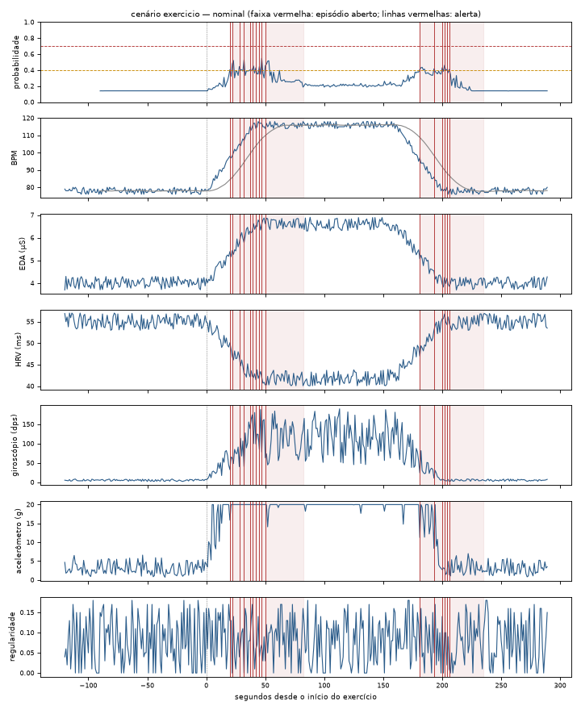

# Modelo preditivo

Como rodar o treino: [Treino](#treino-trainpy), abaixo.

## Arquivos

- `model/features.py` — engenharia de features (usada pelo treino; a
  pulseira calcula as mesmas em `frontend/src/model/predict.js`)
- `model/train.py` — treina e valida (GroupKFold por criança) e exporta
  `frontend/src/model/forest.json`
- `model/gerar_dataset_v4.py` — gerador do dataset sintético v4 (semente
  fixa)
- `data/raw/dataset_pulseira_TEA_estresse_v4.xlsx` — o dataset do treino
- `frontend/src/model/contexto.js` — política de contexto entre a
  probabilidade e o nível (estudo "exercício x crise")
- Scripts dos estudos: `model/comparar_modelos.py` e
  `model/comparar_episodios.mjs` ("Versão simplificada");
  `model/diagnostico_exercicio.mjs`/`.py`, `model/estudo_exercicio.py`,
  `model/calibrar_simulador.py`, `model/tabela_estudo.mjs` e
  `model/validar_sementes.mjs` ("Estudo: exercício x crise")

## Modelo em produção

O `frontend/src/model/forest.json` (o que a pulseira usa) é gerado pelo
`model/train.py`: 60 árvores, profundidade máxima 6, dataset v4, com
validação GroupKFold por criança. As métricas desta página vêm dele.
Conferido em 02/11/2026 e de novo em 08/11/2026 (scikit-learn 1.9.1):
rodar `python model/train.py` gera as mesmas 60 árvores que estão
versionadas.

Desde 08/11/2026 o arquivo é **compactado**: limiares e probabilidades com
4 casas decimais e JSON sem espaços (366 → 273 KB). O `train.py` já grava
assim. Por episódio, isso muda 1 de 1000 eventos do `verificar.js` (ver
"Versão simplificada").

**Política de contexto (desde 11/2026).** Entre a probabilidade e o nível,
o `classify.js` aplica a política "E4d, 30 s" de `frontend/src/model/contexto.js`:
no exercício recente sem EDA elevada e com o batimento explicado pelo
movimento, o alerta exige 30 s seguidos com p ≥ 0,4 e fica no máximo em
"atenção". As árvores e os limiares (0,4 / 0,7) não mudaram. Detalhes,
números e limitações em [Estudo: exercício x crise](#estudo-exercício-x-crise-112026).

O `forest.json` tem um campo `meta` (script de origem, dataset, número de
árvores, data do treino). O `predict.js` ignora esse campo; a pulseira o
mostra no início, e o rodapé do painel do site também ("Modelo: 60 árvores,
treinado em … (model/train.py)").

> Histórico: um treino incremental experimental (`train_incremental.py`,
> com o estado em `model/state/`) e os datasets e scripts de análise
> anteriores (v1, v2, v3 e `model/eda/`) saíram do projeto na limpeza de
> 11/2026. Continuam no histórico do git, por exemplo
> `git show 9f7f8aa:data/raw/dataset_pulseira_TEA_estresse_v3.xlsx > v3.xlsx`.

## Treino (`train.py`)

```bash
pip install pandas scikit-learn openpyxl numpy
python model/train.py
```

Rode na raiz do projeto. Para trocar de dataset, edite a constante `DATASET`
no topo de `model/train.py`. Depois de treinar, reinicie a pulseira (Ctrl+C
e rode de novo) para ela carregar o modelo novo.

Isso reescreve `frontend/src/model/forest.json`, consumido pela pulseira
(`frontend/src/model/predict.js`, chamado por `simulator/borda.js`) — sem
precisar de backend, a inferência roda na própria pulseira (processamento na
borda; num ESP32 real, o modelo teria de ser convertido para C, o que fica
como trabalho futuro). O site não carrega as árvores: lê só o campo `meta`
para o rodapé.

## Decisões de design

**Alvo binário (crise / sem crise), não os 4 rótulos do dataset.**
Testamos multiclasse (nenhum/leve/moderado/alto) primeiro — a fronteira
entre "leve" e "nenhum" é muito ruidosa (F1 chegou a 0.12 em alguns folds).
O binário com probabilidade de saída é uma base mais confiável para um
alerta que vai para um cuidador real; a pulseira converte a probabilidade
em 3 faixas de risco (baixo / atenção / possível crise).

**Feature de "batimento sobe de repente" (jerk) — histórico.**
No dataset v2 (herdado do dataset original), essa feature tinha importância
~0: todo episódio subia de forma igualmente gradual, sem exemplo de "salto
súbito" nos dados. O dataset v3 (gerador histórico, ver "Modelo em produção")
resolve isso: gera episódios com onset súbito (~70%, 5-15s) e gradual
(~30%, 40-90s), e a subida do estresse é sempre um INCREMENTO aditivo sobre
o que já estava acontecendo (nunca um alvo absoluto — isso é um bug real
que corrigimos: antes, um episódio "leve" durante brincadeira_ativa podia
gerar uma *queda* de BPM, porque o alvo absoluto do nível "leve" era mais
baixo que o patamar já elevado da atividade física).

Verificamos diretamente: no instante do início de um episódio (primeiros
~8s), `bpm_jerk` sobe pra média 0,94 contra 0,004 no fundo (~230x maior) —
o sinal existe e é real. Mas a importância AGREGADA da feature no modelo
continua baixa (~0.001): isso é esperado, não é falha. Gini importance
pondera pelo volume total de amostras onde a feature ajuda a decidir, e o
"onset" é só ~0.5% do total de segundos rotulados como estresse (o resto é
platô/recuperação, onde EDA/giroscópio já resolvem sozinhos). Ou seja: a
dinâmica de subida é uma pista real, disponível e correta, só que
estatisticamente pequena diante do volume de dados — mais relevante pra um
sistema de alerta PRECOCE (pegar a subida assim que ela começa) do que pra
classificar a média de uma janela de 30s já elevada.

O que domina a decisão do modelo (e resolve o problema principal — não
confundir exercício com estresse) é outra pista, mais robusta
estatisticamente: no dataset v3, deixamos de propósito a EDA de
`brincadeira_ativa` alta o bastante pra se sobrepor a um episódio "leve"
real (atividade chega a ~6,7 µS em média; estresse "leve" fica em ~5,8) —
ou seja, **EDA sozinha também não resolve mais**, igual ao BPM. O que
resolve é a combinação: `eda_mean_long` + `gyro_mean_long` juntos —
exercício eleva BPM/EDA E giroscópio JUNTOS; estresse real eleva BPM/EDA
mesmo com a criança parada (giroscópio baixo, ~50% dos episódios do
gerador ficam "congelados" no nível de fundo).

## Validação (GroupKFold por criança)

| Dataset | Features | AUC médio | Observação |
|---|---|---|---|
| v2 (histórico) | 12 | 0.985 | mais fácil — EDA sozinha quase resolve |
| v3 (histórico) | 12 | 0.952 | mais difícil de propósito — sobreposição real entre exercício intenso e estresse leve |
| **v4 (atual)** | **24** | **0.960** | mesma dificuldade do v3 + 4 grupos de sinais novos (ver abaixo) |

As linhas v2 e v3 são registro histórico: esses datasets não têm as colunas
de HRV, acelerômetro e ambiente que o `features.py` atual exige (os arquivos
e o código da época estão no histórico do git).

Recall 0.85-0.96, precisão varia bastante por criança (0.27-0.93 entre
folds, v4; valores conferidos no retreino de 02/11/2026) — o modelo erra
mais pro lado de alertar demais do que deixar
passar uma crise real, que é a troca certa pra esse tipo de sistema, mas
é uma limitação real a citar no TCC (a fronteira "leve vs. atividade
física intensa" continua sendo a mais difícil de acertar com precisão).

## v4 — features novas (HRV, acelerômetro, ambiente, tempo elevado)

Gerador: `model/gerar_dataset_v4.py`. Mantém a mesma dinâmica de
onset súbito/gradual do v3, e adiciona:

- **HRV** (`hrv_rmssd_ms`) — cai um pouco com atividade física (acoplada ao
  offset de atividade) e cai MUITO MAIS durante um episódio de estresse
  real (retirada vagal costuma ser mais rápida e mais forte que o simples
  aumento de BPM). Calibrado pra ficar sempre abaixo do nível de exercício
  puro em todas as severidades (nenhum 53,5 > leve 42,2 > moderado 40,7 >
  alto 32,6ms).
- **Acelerômetro + regularidade do movimento** (`acelerometro_magnitude_g`,
  `movimento_regularidade`, 0-1) — a regularidade fica alta especificamente
  quando o episódio de estresse vem com agitação motora visível
  (estereotipia: balançar o corpo, bater as mãos), um padrão fisicamente
  diferente de "correr" (movimento intenso, mas IRREGULAR). Como a
  amostragem é 1Hz, não reconstruímos a forma de onda de alta frequência
  (1-5Hz típico de estereotipia) — simulamos direto o índice resumido,
  como um MPU6050 real reportaria após análise a bordo em alta frequência.

  > **Limitação: escala do acelerômetro irreal (encontrada em 11/2026).** No
  > gerador do v4 (`gerar_dataset_v4.py`) e no simulador (`simulate.js`) o
  > acelerômetro é o giroscópio (dps) × 0,55 × um fator aleatório de 0,5 a
  > 1,6, limitado a [0,02; 20] g. Os dois lados usam a mesma unidade (g) e a
  > mesma fórmula, e o `features.py` e o `predict.js` usam o valor cru, então
  > não há mistura de unidades. Mas a escala não é física: em repouso dá
  > ~2,9 g (o movimento de quem está parado é perto de 0 g) e, acima de ~36
  > dps, satura em 20 g, inclusive em todo exercício e agitação. Uma criança
  > correndo dá ~2–4 g, e o MPU6050 real mede em faixas de ±2, ±4, ±8 ou
  > ±16 g (nunca 20 g). Na prática, o acelerômetro do dataset é uma cópia
  > ruidosa e saturada do giroscópio, sem informação própria (importância
  > somada de 2,3%). As features dele continuam no modelo; o estudo
  > "exercício x crise" usa o **giroscópio** como medida de movimento. A
  > correção da escala fica para um dataset v5 ou para os dados reais.
- **Sensores ambientais** (`luminosidade_lux`, `ruido_db`) — em ~40% dos
  episódios há um pico ambiental coincidente (gatilho plausível); nos
  outros 60% não há correlato externo (crise sem causa óbvia, tão real
  quanto a outra situação).
- **Tempo acumulado em estado elevado** (`bpm_tempo_elevado`) — streak de
  segundos consecutivos, dentro da janela de 30s, em que o BPM ficou acima
  da própria tendência da janela + margem. Não exige histórico extra além
  do que as outras features já usam (dropna continua em 30 amostras).

### Ablação controlada (mesmo dataset v4, só muda o conjunto de features)

| Conjunto de features | AUC | Acurácia | F1 | Recall | Precisão |
|---|---|---|---|---|---|
| 12 antigas (bpm/eda/gyro + idade) | 0.939 | 85.4% | 0.540 | 83.9% | 45.4% |
| **24 completas (v4)** | **0.960** | **91.1%** | **0.669** | **88.7%** | **58.2%** |

Ganho real e isolado das features novas (mesmo split, mesmas crianças de
teste): **+12,8 pontos de precisão**, **+12,9% de F1**. Não é só ruído.

### Importância das features (dataset v4, floresta final)

As duas maiores surpresas: `regularidade_mean_long` ficou em **2º lugar
geral** (15,7%) e a soma das 3 features de HRV chegou a **19,8%** — maior
que giroscópio inteiro. `bpm_jerk`/`bpm_slope_short` continuam com
importância ~0, pelo mesmo motivo documentado acima (onset é uma fatia
pequena do total de segundos).

| Feature | Importância |
|---|---|
| eda_mean_long | 20.4% |
| **regularidade_mean_long** | **15.7%** |
| eda | 13.5% |
| **hrv_mean_long** | **9.9%** |
| eda_slope_long | 9.6% |
| **hrv** | **6.4%** |
| bpm_mean_long | 4.9% |
| **hrv_slope_long** | **3.5%** |
| gyro_mean_long | 3.2% |
| bpm_slope_long | 3.1% |
| bpm | 2.5% |
| accel_mean_long | 1.4% |
| ruido_slope_long | 1.0% |
| accel_mag | 0.9% |
| gyro_slope_long / gyro_mag | 0.8% cada |
| luz_mean_long / idade | 0.6% cada |
| ruido_mean_long | 0.5% |
| bpm_tempo_elevado | 0.3% |
| luz / ruido | 0.2% cada |
| bpm_jerk / bpm_slope_short | ~0% |

### Uma nota sobre "transição abrupta" no simulador manual

Se você mudar os sliders de um salto só (em vez de gradualmente), o modelo
pode marcar risco alto momentaneamente mesmo num cenário de exercício —
isso NÃO é um bug. A janela de 30s ainda contém a mistura entre o estado
anterior e o novo, e uma mudança rápida em qualquer sinal é ambígua até
que se sustente por tempo suficiente (o mesmo aconteceria com um sensor
real). Pra testar "isso é exercício sustentado, não crise", suba os
valores em degraus graduais e espere ~30s+ depois da última mudança antes
de olhar a previsão.

## Versão simplificada (comparação de 11/2026)

Pergunta: dá para ter um modelo mais simples (menos features, menos árvores,
sem luz e ruído nas **entradas**) ou melhor (features com memória) sem
perder nas métricas por episódio? A regra de gatilho (`trigger.js`) não muda
em nenhuma versão: luz e ruído continuam nas leituras, no MQTT, nos gráficos
e na regra; a pergunta é só se o **modelo** precisa deles.

**Decisão (08/11/2026): manter o modelo atual, só compactado.** Nenhuma
versão foi igual ou melhor por episódio sem perder crises (detalhes abaixo).
Os resultados negativos estão registrados de propósito.

### Hipótese da subida súbita (features com memória)

> **Hipótese de projeto, não fato fisiológico validado.** A ideia é que, na
> crise, o batimento sobe de repente (em 5 a 15 s) e sem movimento que
> explique; no exercício, sobe aos poucos e junto com o movimento. Ela está
> **implementada nos dados sintéticos**: o gerador do v4
> (`model/gerar_dataset_v4.py`) faz ~70% das crises com subida súbita
> (5–15 s) e ~30% gradual (40–90 s), e o exercício com transições de 30–50 s;
> desde 11/2026 os cenários do simulador seguem a mesma proporção. Por isso,
> um ganho aqui mostra que o modelo **consegue usar** essa pista se ela
> existir, não que ela exista em crianças reais. **Precisa ser validada com
> dados reais**: no início de um exercício (uma corrida que começa de
> repente) o BPM também sobe rápido nos primeiros segundos, e uma crise pode
> começar devagar.

As três features antigas dessa ideia (`bpm_jerk`, `bpm_slope_short`,
`bpm_tempo_elevado`) têm importância ~0 porque a subida súbita só dura os
primeiros 5–15 s da crise e o modelo decide segundo a segundo, com janelas
de 30 s. As features novas guardam a pista por **90 s** (mesmas contas em
`model/features.py`, `_memory_features`, e em `frontend/src/model/predict.js`,
`memoryFeatures`; conferido em 26.910 segundos de 3 crianças do v4:
diferença zero entre Python e JS):

| Feature | O que mede |
|---|---|
| `bpm_jerk_max_90` | o maior `bpm_jerk` dos últimos 90 s |
| `bpm_excesso_mov` | subida do BPM não explicada pelo movimento: (média de 5 s do BPM − menor valor dela em 90 s) − 0,34 × (o mesmo para o giroscópio). 0,34 bpm/dps é a relação do exercício no v4 (+38 bpm para +112 dps), fixa para não vazar dados da validação |
| `bpm_tempo_subida` | segundos que a média de 5 s do BPM levou de 20% a 80% da subida até o pico mais recente dos 90 s (90 se a subida for menor que 10 bpm) |

Com o modelo atual (sem essas features), nada muda: o `predict.js` só as
calcula se o `forest.json` as usar, e o `classifyAt` passa até 120 leituras
(antes, 31) para o cálculo olhar 90 s para trás.

### Como foi comparado

- **Por segundo:** `python model/comparar_modelos.py --saida <pasta>`, com o
  mesmo GroupKFold por criança (4 folds) do `train.py` no dataset v4 e
  limiar 0,5 para precisão, recall e F1 (todas as previsões fora do fold
  juntas; por isso a precisão aqui é menor que a da ablação acima, que era a
  média dos folds). A linha "atual" reproduz o `forest.json` de produção (60
  árvores idênticas, conferido com scikit-learn 1.9.1).
- **Por episódio:** `node model/comparar_episodios.mjs <pasta>/*.compacto.json --cenarios-antigos <scenarios.js anterior>`
  roda o `simulator/verificar.js` (seeds fixas: laço com 20 sementes × 3
  ciclos por cenário e 1000 eventos aleatórios, seeds 1–50) com cada versão
  compactada (limiares e probabilidades com 4 casas, JSON sem espaços), nos
  cenários com subida súbita/gradual e nos antigos (subida de 30 s). Mede
  também o tempo de inferência por leitura (`classifyAt`).
- Versões: **a** atual (24 features, 60 árvores, profundidade 6); **b** sem
  as features de importância < 1% (`bpm_jerk`, `bpm_slope_short`,
  `bpm_tempo_elevado`, `idade`, `accel_mag`, `gyro_mag`,
  `gyro_slope_long`); **c** b sem luz e ruído (`luz`, `luz_mean_long`,
  `ruido`, `ruido_mean_long`, `ruido_slope_long`); **d** b e c com 30 e 40
  árvores; e as mesmas com as 3 features de memória.

### Por segundo (dataset v4)

| Versão | Features | Árvores | AUC | Precisão | Recall | F1 | Precisão por criança (mín · mediana · máx) | forest.json compacto |
|---|---|---|---|---|---|---|---|---|
| atual (24 features) | 24 | 60 | 0.960 | 0.470 | 0.888 | 0.614 | 0.13 · 0.92 · 0.96 | 267 KB |
| b) sem importância < 1% | 17 | 60 | 0.959 | 0.419 | 0.878 | 0.567 | 0.08 · 0.91 · 0.96 | 275 KB |
| c) b sem ambiente | 12 | 60 | 0.959 | 0.423 | 0.883 | 0.572 | 0.08 · 0.89 · 0.96 | 280 KB |
| b com 30 árvores | 17 | 30 | 0.958 | 0.408 | 0.880 | 0.557 | 0.08 · 0.88 · 0.97 | 140 KB |
| b com 40 árvores | 17 | 40 | 0.959 | 0.416 | 0.881 | 0.565 | 0.08 · 0.89 · 0.96 | 185 KB |
| c com 30 árvores | 12 | 30 | 0.954 | 0.417 | 0.882 | 0.567 | 0.08 · 0.89 · 0.96 | 140 KB |
| c com 40 árvores | 12 | 40 | 0.957 | 0.423 | 0.881 | 0.572 | 0.08 · 0.91 · 0.96 | 186 KB |
| a + memória | 27 | 60 | 0.965 | 0.680 | 0.885 | 0.769 | 0.34 · 0.84 · 0.96 | 277 KB |
| b + memória | 20 | 60 | 0.966 | 0.721 | 0.883 | 0.794 | 0.34 · 0.88 · 0.95 | 274 KB |
| c + memória | 15 | 60 | 0.966 | 0.684 | 0.888 | 0.773 | 0.34 · 0.84 · 0.96 | 282 KB |
| c + memória, 30 árvores | 15 | 30 | 0.966 | 0.701 | 0.889 | 0.784 | 0.34 · 0.84 · 0.96 | 141 KB |
| c + memória, 40 árvores | 15 | 40 | 0.966 | 0.684 | 0.887 | 0.772 | 0.34 · 0.84 · 0.96 | 188 KB |
| b + memória, 30 árvores | 20 | 30 | 0.966 | 0.716 | 0.883 | 0.791 | 0.34 · 0.84 · 0.95 | 137 KB |
| b + memória, 40 árvores | 20 | 40 | 0.966 | 0.716 | 0.884 | 0.791 | 0.34 · 0.85 · 0.95 | 184 KB |
| 12 antigas (ablação) | 12 | 60 | 0.939 | 0.337 | 0.840 | 0.481 | 0.08 · 0.84 · 0.97 | 289 KB |

### Por episódio (simulador, cenários com subida súbita/gradual)

| Versão | Crises detectadas (eventos) | Crises certas no laço | Exercício no laço: sem alerta · só atenção · possível crise (de 60) | Exercício (eventos) com alarme | barulho_sem_crise sem alerta (de 60) | Ambiente sem crise (eventos) com alarme | calmo sem alerta (de 60) | Episódios nas pausas calmas (eventos) | Tempo até o alerta | KB |
|---|---|---|---|---|---|---|---|---|---|---|
| atual (antes de compactar) | 852/852 | 420/420 | 0 · 37 · 23 | 96/96 | 40 | 21/52 | 60 | 0 | 6,4 s | 358 |
| **atual, compactado (em produção)** | 852/852 | 420/420 | 0 · 37 · 23 | 96/96 | 40 | 22/52 | 60 | 0 | 6,4 s | 267 |
| b) sem importância < 1% | 831/852 | 400/420 | 0 · 44 · 16 | 96/96 | 18 | 36/52 | 34 | 182 | 6,1 s | 275 |
| c) b sem ambiente | 806/852 | 392/420 | 0 · 35 · 25 | 96/96 | 24 | 30/52 | 18 | 324 | 6,6 s | 280 |
| b, 30 árvores | 793/852 | 380/420 | 0 · 42 · 18 | 96/96 | 13 | 41/52 | 17 | 410 | 6,2 s | 140 |
| b, 40 árvores | 818/852 | 396/420 | 0 · 47 · 13 | 96/96 | 17 | 36/52 | 23 | 259 | 6,4 s | 185 |
| c, 30 árvores | 810/852 | 396/420 | 0 · 30 · 30 | 96/96 | 25 | 29/52 | 21 | 277 | 6,8 s | 140 |
| c, 40 árvores | 807/852 | 388/420 | 0 · 37 · 23 | 96/96 | 24 | 29/52 | 20 | 292 | 6,7 s | 186 |
| a + memória | 837/852 | 410/420 | 0 · 49 · 11 | 96/96 | 37 | 22/52 | 41 | 125 | 6,7 s | 277 |
| b + memória | 848/852 | 412/420 | 0 · 38 · 22 | 96/96 | 56 | 6/52 | 50 | 37 | 7,5 s | 274 |
| c + memória | 820/852 | 404/420 | 0 · 29 · 31 | 96/96 | 32 | 28/52 | 29 | 244 | 7,1 s | 282 |
| c + memória, 30 árvores | 841/852 | 412/420 | 0 · 31 · 29 | 96/96 | 50 | 10/52 | 47 | 85 | 7 s | 141 |
| c + memória, 40 árvores | 822/852 | 407/420 | 0 · 31 · 29 | 96/96 | 35 | 23/52 | 31 | 220 | 6,9 s | 188 |
| b + memória, 30 árvores | 839/852 | 411/420 | 0 · 42 · 18 | 96/96 | 44 | 12/52 | 40 | 142 | 7,6 s | 137 |
| b + memória, 40 árvores | 843/852 | 411/420 | 0 · 41 · 19 | 96/96 | 47 | 10/52 | 43 | 117 | 7,5 s | 184 |
| 12 antigas (ablação) | 852/852 | 420/420 | 0 · 44 · 16 | 96/96 | 60 | 0/52 | 60 | 0 | 6,9 s | 289 |

"Episódios nas pausas calmas" são episódios abertos sem evento nenhum (a
criança calma entre um evento e outro): também são alarmes falsos. Tempo de
inferência por leitura (`classifyAt`): ~0,01 ms nas versões sem memória e
~0,04 ms nas com memória, irrisório nos dois casos. Nos cenários antigos
(subida de 30 s) as conclusões são as mesmas.

### Limiares mais baixos para "b + memória"

Teste para ver se limiares de alerta mais baixos recuperam as crises que
"b + memória" perde (o limiar fica no `predict.js`, `riskTierFromProbability`;
`node model/comparar_episodios.mjs <forest.json> --limiares 0.35,0.65`):

| b + memória, limiares (atenção / possível crise) | Precisão · recall por segundo no limiar de atenção | Crises detectadas (eventos) | Crises certas no laço | barulho_sem_crise sem alerta (de 60) | calmo sem alerta (de 60) | Episódios nas pausas calmas (eventos) | Exercício no laço: sem alerta · só atenção · possível crise |
|---|---|---|---|---|---|---|---|
| 0,40 / 0,70 (padrão) | 0,590 · 0,902 | 848/852 | 412/420 | 56 | 50 | 37 | 0 · 38 · 22 |
| 0,35 / 0,65 | 0,476 · 0,913 | 840/852 | 411/420 | 45 | 42 | 125 | 0 · 22 · 38 |
| 0,30 / 0,60 | 0,361 · 0,925 | 824/852 | 405/420 | 34 | 30 | 204 | 0 · 4 · 56 |
| 0,35 / 0,70 | 0,476 · 0,913 | 840/852 | 411/420 | 45 | 42 | 125 | 0 · 38 · 22 |
| 0,25 / 0,55 | 0,268 · 0,942 | 797/852 | 402/420 | 22 | 18 | 330 | 0 · 0 · 60 |
| *atual, para comparar: 0,40 / 0,70* | *0,330 · 0,911* | *852/852* | *420/420* | *40* | *60* | *0* | *0 · 37 · 23* |

**Não recupera, piora.** Baixar o limiar faz o modelo abrir mais episódios
nas pausas calmas (de 37 para 125 e para 330), e um episódio que ainda está
aberto quando a crise seguinte começa "engole" essa crise: ela não gera
episódio próprio e conta como não detectada. Por isso as crises detectadas
**caem** (848 → 840 → 797) em vez de subir, e o barulho sem crise e o calmo
também pioram. A precisão por segundo no limiar de atenção continua maior
que a do atual, mas isso não aparece por episódio.

### O que os números dizem

- **A hipótese da subida súbita ajuda por segundo, mas não resolve o
  exercício.** Com as features de memória, a precisão por segundo sobe de
  0,47 para 0,68–0,72 (F1 de 0,61 para 0,77–0,79; a pior criança, de 0,13
  para 0,34), com o mesmo recall (~0,88), e duas delas viram as mais
  importantes do modelo (`bpm_excesso_mov` 15–19%, `bpm_tempo_subida`
  9–13%). Mas, por episódio, **todas** as versões continuam alarmando nos 96
  de 96 exercícios dos eventos aleatórios e nos 60 de 60 ciclos de
  exercício. O motivo, visto no diagnóstico: o pico de probabilidade vem no
  **começo** do exercício ("começando a correr"), quando o BPM ainda está
  subindo e o trecho já subido parece súbito (`bpm_tempo_subida` = 13 s), que
  é exatamente a ressalva da hipótese. O que muda é a proporção entre "só
  atenção" e "possível crise".
- **Só o modelo atual (e as "12 antigas") não alarmam na calma.** Todas as
  outras versões abrem episódios no cenário `calmo` e nas pausas calmas dos
  eventos aleatórios; o atual tem 60/60 e 0.
- **b + memória** é a melhor das novas no barulho sem crise (56 de 60 ciclos
  sem alerta; atual: 40) e nos eventos de ambiente (6 de 52 com alarme;
  atual: 22), mas perde 4 de 852 crises nos eventos e 8 de 420 no laço,
  alarma em 10 de 60 ciclos do `calmo`, abre 37 episódios nas pausas e
  alerta ~1 s mais tarde. Com limiares mais baixos fica pior (acima).
- **Simplificar piora (resultado negativo).** Tirar as features de
  importância < 1% (b) ou também luz e ruído (c) perde de 21 a 46 das 852
  crises, **aumenta** os alarmes do barulho sem crise (18 a 25 de 60 ciclos
  sem alerta, contra 40) e passa a alarmar na calma. Importância baixa (Gini)
  não quer dizer feature inútil: luz e ruído ajudam o modelo a **não**
  confundir ambiente barulhento com crise. Menos árvores (30 ou 40) piora
  mais.
- **Compactar o atual** (4 casas, sem espaços) reduz o arquivo de 358 para
  267 KB e muda 1 de 1000 eventos (um alarme a mais num ambiente sem crise).
  **Aplicado em 08/11/2026.**
- **As 12 antigas** (sem HRV, regularidade, acelerômetro e ambiente) vão
  muito bem nos cenários do simulador (852/852 crises, nenhum alarme na calma
  ou no barulho), mas são as piores por segundo no dataset (precisão 0,34,
  recall 0,84, AUC 0,939): os cenários do simulador são mais "limpos" que o
  dataset, e por isso as duas medidas precisam ser lidas juntas.

### Conclusão (para Resultados e Limitações do TCC)

**Resultado negativo da hipótese da subida súbita.** A memória da subida
súbita do batimento (maior salto dos últimos 90 s, subida não explicada pelo
movimento e tempo de subida) **melhora a precisão segundo a segundo** no
dataset sintético (de 0,47 para até 0,72, com o mesmo recall), mas **não
reduz os alarmes falsos do exercício**: em todas as versões, os 96
exercícios dos eventos aleatórios continuam gerando alerta. O motivo é que
o **início do exercício também tem subida rápida** do batimento, e é nele
que o modelo alerta. Além disso, as versões com memória perdem algumas
crises e passam a alertar em momentos calmos. Por isso o modelo atual foi
mantido (só compactado). Distinguir exercício de crise continua sendo a
principal limitação do sistema; a hipótese, implementada só nos dados
sintéticos, precisa de dados reais para ser confirmada ou descartada, e
outras pistas (contexto da atividade, confirmação do cuidador) tendem a ser
necessárias. O estudo seguinte ([Estudo: exercício x crise](#estudo-exercício-x-crise-112026))
testou essas pistas.

O que fica no código: o modelo atual compactado; as features de memória em
`features.py` e `predict.js`, prontas para testar com dados reais (só são
calculadas se um `forest.json` as pedir; com o atual, o `verificar.js` e os
testes não mudam); os dois scripts de comparação; e os cenários com subida
súbita/gradual.

## Estudo: exercício x crise (11/2026)

Pergunta: dá para reduzir os alarmes falsos do exercício (o modelo da
"Versão simplificada" alertava em 96 de 96 exercícios dos eventos aleatórios
e em 60 de 60 ciclos do laço) e do barulho sem crise (20 de 60 ciclos), **sem
perder nenhuma crise**? O estudo seguiu abordagens da literatura. Os tópicos
MQTT, os formatos, a regra de gatilho (`trigger.js`) e os sensores não
mudaram.

**Decisão (09/11/2026): política de contexto "E4d, 30 s" em produção**
(`frontend/src/model/contexto.js`), **sem trocar o `forest.json`** (as mesmas
60 árvores). É a versão mais simples entre as testadas e a única família que
não perdeu crise nas sementes do estudo.

- **N = 30 s foi escolhido depois de ver a validação com sementes novas**
  (101–300). Antes dela, a recomendação era N = 20 s. O 30 s é igual ou
  melhor que o 20 s em todas as medidas, nas sementes do estudo e nas novas.
- **O critério de 0 crises engolidas não foi cumprido nas sementes novas:**
  sobra 1 por intensidade no `exercicio_e_crise` (semente 143, também
  engolida pelo modelo sem política).
- **A política foi mantida porque** reduz as engolidas de 30–37 para 1 por
  intensidade e os alarmes do exercício em 45% (de 409 para 224 de 409
  eventos), **sem perder nenhuma crise** que o modelo sem política detecta.
- **O custo são atrasos de até 45 s** em relação ao modelo sem política, no
  mesmo ciclo: acima de +30 s em 1 de 600 ciclos do `exercicio_e_crise` leve
  (máximo +36 s) e em 3 de 600 da `crise_com_agitacao` leve (máximo +45 s).
- **Os atrasos são iguais com N = 10, 20 e 30 s.** Não vêm do teto pela EDA
  nem do tamanho de N: testado nos 8 ciclos atrasados, só o teto (sem
  persistência) não atrasa nenhum; a persistência com N = 10 ou 30 dá os
  mesmos tempos. Nesses ciclos, a probabilidade da crise leve oscila perto de
  0,4 e nunca fica 10 s seguidos acima; o alerta só sai quando a condição da
  política desliga (a EDA passa de 3,5 µS ou o batimento sai da faixa de
  ±10 bpm).

Detalhes em [Validação com sementes novas](#validação-com-sementes-novas-101300).
Os resultados negativos estão registrados de propósito.

### Fundamentação

- **Contexto de atividade em duas etapas.** Gjoreski et al. (2016, 2017) e
  Cvetković et al. (2017) reconhecem primeiro a atividade pelo acelerômetro e
  usam essa atividade (e o histórico das previsões) como contexto do detector
  de estresse; um estudo da *BMC Medical Informatics and Decision Making*
  (2022) mostra que modelos com contexto de atividade superam os só
  fisiológicos.
- **Batimento adicional (não metabólico).** Myrtek et al. (2000) e Brouwer et
  al. (2018, *Frontiers in Human Neuroscience*) estimam o batimento esperado
  pelo movimento e usam o que sobra; Verkuil et al. (2016) e Versluis et al.
  (2020) fazem o mesmo com a HRV ("additional HRV reduction"), com calibração
  individual.
- **EDA x esforço.** Bosch (2026, arXiv 2605.15756): a EDA tônica responde de
  forma aditiva ao estresse e ao esforço; o BPM e a RMSSD são dominados pelo
  esforço físico.
- **Modelos por pessoa e movimento como pista.** Goodwin et al. (2019):
  modelos personalizados (AUC média 0,84) superam o global (0,71) no TEA, e o
  movimento também é pista de crise.

### Diagnóstico

Scripts: `model/diagnostico_exercicio.mjs` (curvas, exercício parecido com o
dataset, features do simulador) e `model/diagnostico_exercicio.py` (dataset
v4 e gráficos).

- **Onde o alarme nasce.** No cenário `exercicio`, o alerta dispara no
  **início** (20–50 s, "começando a correr") e de novo na **desaceleração**
  (180–205 s), quase sempre como "atenção":

  

  (também [semente 2](imagens/estudo-exercicio/exercicio_seed2.png) e
  [semente 3](imagens/estudo-exercicio/exercicio_seed3.png); faixa vermelha =
  episódio aberto, linhas vermelhas = alertas.)
- **Não é diferença entre simulador e dataset.** Um exercício montado com o
  BPM calmo do dataset (85, 92, 100 bpm em vez de 78) e a subida em cosseno de
  30–50 s (em vez da rampa reta de 40 s) alarmou em 60 de 60 execuções em
  todas as variantes (pico mediano 0,62–0,65). O cenário oficial não mudou.
- **O problema existe no próprio dataset.** O v4 tem 66 entradas em
  brincadeira_ativa (56 sem estresse nos 90 s seguintes; 3.811 s de início,
  3,8% dos segundos sem estresse). Fora do fold, **44 dos 56 inícios passam de
  0,4 e 10 de 0,7**; por segundo, p ≥ 0,4 em 29,8% do início, 8,3% do platô e
  30,3% da saída do exercício.
- **Causa 1, as inclinações.** Zerar as inclinações de EDA, HRV e BPM nos
  inícios derruba p ≥ 0,4 de 15,7% para 3,3% (modelo final). "EDA subindo e
  HRV caindo com movimento ainda médio" se parece com as crises com agitação
  do v4 (2.673 s de estresse com giroscópio médio de 40–80 dps).
- **Causa 2, níveis absolutos.** No repouso do v4, C03 (HRV de repouso 29 ms)
  e C06 (45 ms) ficam com p ≥ 0,4 em 99% e 98% do tempo; as outras 10
  crianças, em no máximo 6%. O modelo usa níveis absolutos de HRV, EDA e BPM.
- **Acelerômetro** (ver a limitação na seção v4): é uma cópia saturada do
  giroscópio; o estudo usa o giroscópio como medida de movimento.

**Cenários novos** (`simulator/scenarios.js`; no laço do `verificar.js`, com
`--nivel leve|moderada|alta`; fora do sorteio do `eventos_aleatorios`):

- `crise_com_agitacao`: crise com giroscópio ~125 dps e regularidade baixa
  (movimento intenso e **irregular**). O movimento não soma batimento extra,
  como nos episódios com agitação do v4: é o caso mais difícil para quem
  desconta o batimento explicado pelo movimento.
- `exercicio_e_crise`: a crise soma por cima do exercício, 60 s depois do
  platô. Conta como detectada se um episódio próprio começa na crise **ou** se
  o episódio aberto pelo exercício **sobe de nível** (atenção → possível
  crise) durante ela; senão, a crise foi "engolida".

**Subida de nível no app.** A pulseira já publicava um alerta a cada subida
de nível no mesmo episódio, mas o app só atualizava a notificação em
silêncio. Desde 11/2026 a subida toca de novo (mesma notificação), e só ela:
alerta repetido no mesmo nível ou descendo não notifica
([app.md](app.md#notificações)).

### Experimentos

| Versão | O que muda | `forest.json` |
|---|---|---|
| **E4** persistência N s | Política de alerta: no exercício recente (giroscópio ≥ 40 dps nos últimos 60 s, sem movimento repetitivo) e sem EDA nem batimento elevados, o alerta exige p ≥ 0,4 em cada um dos últimos N s (N = 10, 20, 30) | igual |
| **E4** rebaixa | Mesma condição; em vez de esperar, rebaixa para "atenção" | igual |
| **E4b** | E4 + "batimento explicado": a política só vale se o batimento também não estiver muito **abaixo** do esperado pelo movimento | igual |
| **E4c** | E4b + teto de "atenção" dentro da mesma condição | igual |
| **E4d** | E4b + teto de "atenção" com condição própria: exercício recente, EDA não elevada e batimento não muito abaixo do esperado (não olha se o batimento está acima) | igual |
| **E2a** | + features relativas à linha de base (percentil 10 dos últimos 300 s; 90 na HRV): BPM, HRV, EDA tônica, giroscópio e a inclinação suave do giroscópio | novo |
| **E2b** | E2a + batimento esperado pelo movimento, resíduo do BPM e da HRV (coeficientes por mínimos quadrados, ajustados só nas crianças de treino de cada dobra) | novo |
| **E2c** | E2b + inclinações de EDA, HRV e BPM descontadas da parte explicada pela inclinação do movimento (variante pedida: desconta, não zera) | novo |
| E2 "só relativas" | E2a ou E2c **sem** os níveis absolutos (bpm, eda, hrv e suas médias) | novo |
| **E2d** com rótulo | E2c com calibração individual: linha de base e coeficientes de cada criança a partir dos primeiros 10 min calmos e 5 min ativos **sem estresse** (usa os rótulos) | novo |
| **E2d** sem rótulo | Linha de base fixa dos primeiros 5 min de cada criança, sem olhar rótulo nenhum; coeficientes globais | novo |
| **E3** | + contexto de atividade por regras (repouso, andando, exercício irregular, movimento repetitivo, exercício nos últimos 60 s) como feature; regularidade alta é sempre "repetitivo" | novo |
| **E5** | Combinações: E2 só relativas + E4b/E4c | novo |
| E1 (v5) | Dataset com mais transições e crises agitadas | **não rodado**: só se nenhuma outra cumprisse o critério |

Features novas: `model/features.py` (`BASE_FEATURES`, `RESIDUAL_FEATURES`,
`SLOPE_RESIDUAL_FEATURES`, `CONTEXT_FEATURES`) e as mesmas contas no
`predict.js` (só calculadas se um `forest.json` as usar; diferença máxima
Python × JS de 7·10⁻¹⁴ em 4.410 s de 3 crianças). O `train.py` continua
gerando as mesmas 60 árvores.

### Como foi comparado

- **Por segundo:** `python model/estudo_exercicio.py --saida <pasta>` (mesmo
  GroupKFold por criança do `train.py`). Diferente da "Versão simplificada",
  as métricas são no **ponto de operação do alerta**: alerta = p ≥ 0,4 depois
  da política (por isso a precisão do atual aqui é 0,330, não 0,470). "Repouso
  com alerta" = % dos segundos calmos sem estresse com alerta, por criança.
- **Por episódio:** `node model/comparar_episodios.mjs <forest.json> [--politica '<json>' | --politica null]`
  (o `verificar.js` padrão: laço de 20 sementes × 3 ciclos e 1000 eventos,
  seeds 1–50) e, ciclo a ciclo, os cenários novos nas 3 intensidades;
  `node model/tabela_estudo.mjs` monta as tabelas. Calibração da criança
  simulada: `python model/calibrar_simulador.py`.
- **Validação:** `node model/validar_sementes.mjs` com as sementes 101–300,
  nunca usadas no estudo.

### Por segundo (dataset v4)

| Versão | AUC | Precisão | Recall | F1 | Precisão por criança (mín · mediana · máx) | Repouso com alerta por criança (mín · mediana · máx) | C03 · C06 em repouso | KB |
|---|---|---|---|---|---|---|---|---|
| atual (sem política) | 0,960 | 0,330 | 0,911 | 0,484 | 0,08 · 0,82 · 0,91 | 0% · 2% · 99% | **99% · 98%** | 267 |
| E4 persistência 10 / 20 / 30 s | 0,960 | 0,345 / 0,349 / 0,352 | 0,889 / 0,882 / 0,881 | 0,497 / 0,500 / 0,503 | 0,08 · 0,89 · 0,94 | 0% · 1% · 98–99% | 98–99% · 93–96% | 267 |
| E4 rebaixa | 0,960 | 0,330 | 0,911 | 0,484 | 0,08 · 0,82 · 0,91 | 0% · 2% · 99% | 99% · 98% | 267 |
| E4b/E4c/E4d 10 s | 0,960 | 0,341 | 0,891 | 0,493 | 0,08 · 0,85 · 0,93 | 0% · 2% · 99% | 99% · 97% | 267 |
| E4b/E4c/E4d 20 s | 0,960 | 0,342 | 0,885 | 0,494 | 0,08 · 0,85 · 0,93 | 0% · 2% · 99% | 99% · 96% | 267 |
| **E4b/E4c/E4d 30 s (em produção)** | 0,960 | **0,344** | **0,884** | **0,496** | 0,08 · 0,85 · 0,93 | 0% · 2% · 99% | **99% · 95%** | 267 |
| E2a | 0,975 | 0,769 | 0,929 | 0,842 | 0,38 · 0,87 · 0,93 | 0% · 1% · 3% | 1% · 3% | 270 |
| E2b | 0,976 | 0,829 | 0,927 | 0,876 | 0,40 · 0,90 · 0,95 | 0% · 1% · 1% | 1% · 1% | 253 |
| E2c | 0,977 | 0,823 | 0,932 | 0,874 | 0,40 · 0,89 · 0,93 | 0% · 1% · 1% | 1% · 1% | 258 |
| E2a só relativas | 0,977 | 0,853 | 0,931 | 0,890 | 0,73 · 0,86 · 0,90 | 0% · 1% · 2% | 1% · 2% | 273 |
| E2c só relativas | 0,978 | 0,883 | 0,933 | 0,907 | 0,82 · 0,88 · 0,91 | 0% · 1% · 1% | 1% · 1% | 261 |
| E2d com rótulo (E2c) | 0,977 | 0,885 | 0,933 | 0,908 | 0,76 · 0,90 · 0,94 | 0% · 1% · 1% | 1% · 1% | 257 |
| E2d com rótulo (só relativas) | 0,977 | 0,886 | 0,935 | 0,910 | 0,81 · 0,89 · 0,93 | 0% · 1% · 2% | 1% · 1% | 247 |
| E2d sem rótulo (E2c) | 0,975 | 0,875 | 0,933 | 0,903 | 0,78 · 0,89 · 0,94 | 0% · 1% · 3% | 2% · 1% | 258 |
| E2d sem rótulo (só relativas) | 0,976 | 0,895 | 0,932 | 0,913 | 0,83 · 0,91 · 0,95 | 0% · 0% · 2% | 1% · 1% | 255 |
| E3 | 0,961 | 0,340 | 0,913 | 0,496 | 0,08 · 0,83 · 0,93 | 0% · 2% · 99% | 99% · 77% | 245 |

As features relativas à linha de base resolvem C03 e C06 (99%/98% → 1%) e
sobem a precisão de 0,33 para 0,77–0,90, com recall maior. Os coeficientes
ajustados no treino (0,30 bpm/dps; 0,13 ms/dps) ficam perto da relação do
gerador (0,34 bpm/dps). A calibração sem rótulo mantém o resultado por
segundo, mesmo com 6 das 12 crianças em crise nos primeiros 5 min e C04
começando em brincadeira (linha de base de 132 bpm; recall dela 0,92 →
0,91). A política (E4) quase não muda as métricas por segundo: os alarmes
falsos do dataset estão sobretudo no repouso de C03 e C06, que ela não toca.

### Por episódio (simulador, sementes do estudo)

`exercicio_e_crise` e `crise_com_agitacao`: laço de 20 sementes × 3 ciclos em
cada intensidade (leve · moderada · alta, de 60). Exercício no laço: sem
alerta · só atenção · possível crise (de 60).

| Versão | Crises (1000 eventos) | Crises no laço (7 cenários) | Agitada L · M · A | Exercício + crise L · M · A (engolidas) | Exercício no laço | Exercício (eventos) com alarme | Barulho sem crise sem alerta | Calmo · pausas | ms/leitura |
|---|---|---|---|---|---|---|---|---|---|
| atual (sem política) | 852/852 | 420/420 | 60 · 60 · 60 | 55 · 55 · 54 (5 · 5 · 6) | 0 · 37 · 23 | 96/96 | 40 | 60 · 0 | 0,012 |
| E4 persistência 10 s | 852 | 420 | **48** · 60 · 60 | 58 · 58 · 58 (2 · 2 · 2) | 23 · 28 · 9 | 65 | 40 | 60 · 0 | 0,083 |
| E4 persistência 20 s | 852 | 420 | **36** · 60 · 60 | 60 · 59 · 59 (0 · 1 · 1) | 30 · 27 · 3 | 55 | 40 | 60 · 0 | 0,082 |
| E4 persistência 30 s | 852 | 420 | **27** · 60 · 60 | 60 · 59 · 59 (0 · 1 · 1) | 30 · 27 · 3 | 52 | 40 | 60 · 0 | 0,078 |
| E4 rebaixa | 852 | 420 | 60 · 60 · 60 | 59 · 59 · 59 (1 · 1 · 1) | 0 · 57 · 3 | 96 | 40 | 60 · 0 | 0,077 |
| E4b 10 s | 852 | 420 | 60 · 60 · 60 | 58 · 58 · 58 (2 · 2 · 2) | 21 · 30 · 9 | 67 | 40 | 60 · 0 | 0,061 |
| E4b 20 s (E4c igual) | 852 | 420 | 60 · 60 · 60 | 60 · 59 · 59 (0 · 1 · 1) | 27 · 30 · 3 | 58 | 40 | 60 · 0 | 0,060 |
| E4b 30 s | 852 | 420 | 60 · 60 · 60 | 60 · 59 · 59 (0 · 1 · 1) | 27 · 30 · 3 | 57 | 40 | 60 · 0 | 0,068 |
| E4d 10 s | 852 | 420 | 60 · 60 · 60 | 60 · 60 · 60 (0) | 21 · 39 · 0 | 67 | 40 | 60 · 0 | 0,072 |
| E4d 20 s | 852 | 420 | 60 · 60 · 60 | 60 · 60 · 60 (0) | 27 · 33 · 0 | 58 | 40 | 60 · 0 | 0,086 |
| **E4d 30 s (em produção)** | **852** | **420** | **60 · 60 · 60** | **60 · 60 · 60 (0)** | **27 · 33 · 0** | **57** | **40** | **60 · 0** | 0,059 |
| E2a | **850** | **414** | 59 · 59 · 59 | 60 · 60 · 60 (0) | 0 · 57 · 3 | 96 | 45 | **52 · 26** | 0,210 |
| E2b | 852 | 420 | **31** · 60 · 60 | 60 · 60 · 60 (0) | 28 · 32 · 0 | 38 | 60 | 60 · 0 | 0,179 |
| E2c | 852 | 420 | **47** · 60 · 60 | 60 · 60 · 60 (0) | 27 · 33 · 0 | 40 | 60 | 60 · 1 | 0,212 |
| E2a só relativas | 852 | 420 | 60 · 60 · 60 | 58 · 58 · 58 (2 · 2 · 2) | 0 · 54 · 6 | 96 | 60 | 60 · **2** | 0,192 |
| E2c só relativas | 852 | 420 | **45** · 60 · 60 | 60 · 60 · 60 (0) | 29 · 30 · 0 | 49 | 60 | 60 · 0 | 0,229 |
| E2d com rótulo (E2c) | 852 | 420 | **46** · 60 · 60 | 60 · 60 · 60 (0) | 34 · 24 · 2 | 51 | 60 | 60 · 0 | 0,014 |
| E2d com rótulo (só relativas) | 852 | 420 | **34** · 60 · 60 | 56 · 56 · 56 (4 · 4 · 4) | 29 · 22 · 9 | 60 | 60 | 60 · 0 | 0,016 |
| E2d sem rótulo (E2c) | **850** | **410** | **42** · 59 · 59 | 60 · 60 · 60 (0) | 31 · 29 · 0 | 44 | 53 | **56 · 32** | 0,022 |
| E2d sem rótulo (só relativas) | 852 | 420 | **29** · 60 · 60 | 59 · 59 · 59 (1 · 1 · 1) | 28 · 32 · 0 | 54 | 58 | 60 · 0 | 0,021 |
| E3 | **837** | **406** | 60 · 58 · 58 | 59 · 59 · 59 (1 · 1 · 1) | 0 · 55 · 5 | 96 | **20** | **48 · 79** | 0,040 |
| E5: E2a só relativas + E4b 20 / 30 s | 852 | 420 | 60 · 60 · 60 | 58 · 58 · 58 (2 · 2 · 2) | 40 · 15 · 5 | 39 / 35 | 60 | 60 · **2** | 0,24 |
| E5: E2a só relativas + E4c 30 s | 852 | 420 | 60 · 60 · 60 | 59 · 59 · 59 (1 · 1 · 1) | 40 · 19 · 0 | 35 | 60 | 60 · **2** | 0,248 |
| E5: E2c só relativas + E4b 20 s | 852 | 420 | **43** · 60 · 60 | 60 · 60 · 60 (0) | 47 · 12 · 0 | 21 | 60 | 60 · 0 | 0,231 |

Com o E4d 30 s (e o 20 s): crises leves 248/248, gatilho certo 851/852 e tempo médio
até o alerta 6,4 s, iguais ao atual; `demo` 60/60 no laço (atual 51/60).
Maior atraso contra o atual, no mesmo ciclo: +12 s no `exercicio_e_crise`
(leve) e +20 s num ciclo da crise agitada leve (máximo 51 s, atual 43 s).

O que os números dizem:

- **Descontar o movimento esconde a crise agitada.** Todas as versões com
  resíduo do batimento (E2b, E2c, E2d, E5 com E2c) perdem de 13 a 31 das 60
  crises agitadas leves. É o risco previsto: a crise leve com agitação forte
  (BPM +11 com 125 dps) tem batimento **abaixo** do que o movimento
  explicaria. No v4, a crise leve com agitação tem giroscópio de só 14–41
  dps, então esse caso não existe no treino.
- **A persistência sozinha também esconde** (E4: 12 a 33 agitadas leves
  perdidas). A regra "batimento explicado" (E4b) corrige: com batimento muito
  abaixo do esperado, o movimento não é um exercício típico.
- **O caso que o E4b ainda engolia** (1 ciclo): aos 80 s de exercício, o
  resíduo do batimento encostou em 10 bpm por ruído, a política desligou, saiu
  "possível crise" no exercício e a crise, 28 s depois, só gerou um alerta que
  o app não notifica (o episódio já estava em possível crise). O teto de
  "atenção" do E4d, que só a EDA libera, resolve esse caso.
- **O E3 piora** (perde 15 crises, 79 episódios nas pausas, barulho 20/60): o
  contexto como feature, treinado no v4, não generaliza para o simulador.
- **As relativas resolvem o barulho sem crise** (60/60), mas só sem o resíduo
  (E2a só relativas) elas não escondem a crise agitada, e aí o exercício
  continua alarmando (96/96) e aparecem episódios de 1 s nas pausas.

### Validação com sementes novas (101–300)

O E4d foi ajustado depois de ver o caso da semente 3. Rodado de novo com as
sementes 101–300 (nunca usadas no estudo): 4.000 eventos, 600 ciclos por
cenário e intensidade.

| Versão | Crises (eventos) | Crises no laço (7 cenários) | Agitada L · M · A | Exercício + crise L · M · A | Engolidas | Exercício no laço (de 600) | Exercício (eventos) com alarme | Barulho sem crise sem alerta | Calmo | Pausas |
|---|---|---|---|---|---|---|---|---|---|---|
| sem política | 3401/3402 | 4200/4200 | 600 · 600 · 600 | 570 · 566 · 563 | 30 · 34 · 37 | 0 · 438 · 162 | 409/409 | 382/600 | 600/600 | 2 |
| E4d 10 s | 3401/3402 | 4200/4200 | 600 · 600 · 600 | 598 · 598 · 598 | 2 · 2 · 2 | 205 · 387 · 8 | 269/409 | 382/600 | 600/600 | 2 |
| E4d 20 s | 3401/3402 | 4200/4200 | 600 · 600 · 600 | 598 · 598 · 598 | 2 · 2 · 2 | 263 · 329 · 8 | 234/409 | 382/600 | 600/600 | 2 |
| **E4d 30 s (em produção)** | 3401/3402 | 4200/4200 | 600 · 600 · 600 | 599 · 599 · 599 | **1 · 1 · 1** | 277 · 315 · 8 | **224/409** | 382/600 | 600/600 | 2 |

- **Nenhuma crise perdida pela política:** o E4d detecta todas as que o
  modelo sem política detecta (a crise de 3402 que falta é a mesma nos
  dois).
- **Engolidas: 1 por intensidade com N = 30 s (semente 143) e 2 com N = 10
  ou 20 s (sementes 107 e 143); são ciclos que o modelo sem política também
  engole**: o E4d não as cria, mas não as resolve todas. O critério pedia 0.
- **Atrasos acima de 30 s** contra o modelo sem política, no mesmo ciclo
  (iguais com N = 10, 20 e 30 s): no `exercicio_e_crise` leve, máximo +36 s e
  1 de 600 ciclos acima de +30 s; na `crise_com_agitacao` leve, máximo +45 s
  e 3 de 600 acima de +30 s. Nas outras intensidades, no máximo +15 s
  (moderada) e +11 s (alta) no `exercicio_e_crise` e 0 na agitada. Nos casos
  leves, o início da crise ainda parece exercício (EDA abaixo de 3,5 µS,
  batimento perto do esperado): a probabilidade oscila perto de 0,4, a
  persistência nunca se completa, e o alerta só sai quando a condição da
  política desliga. Por isso o atraso não depende de N.
- **Exercício (N = 30 s):** de 409/409 para 224/409 eventos com alarme e de
  0 para 277/600 ciclos sem nenhum alerta; "possível crise" no exercício de
  162 para 8 ciclos.

### Origem dos limites do E4d

Os limites (`CONTEXTO`, em `contexto.js`) foram tirados das **constantes do
gerador do v4** (`model/gerar_dataset_v4.py`), não do simulador nem de dados
reais:

| Limite | Valor | Regra |
|---|---|---|
| EDA elevada | 3,5 µS acima da linha de base | ponto médio entre a EDA da brincadeira ativa (+2,6 µS) e a da brincadeira + crise leve (+2,6 + 2,1 = 4,7), arredondado para baixo (desliga a política antes: lado seguro) |
| Batimento muito acima / abaixo do esperado | ±10 bpm | o BPM da crise leve (+11), arredondado para baixo |
| Batimento esperado pelo movimento | 0,34 bpm/dps | +38 bpm para +112 dps da brincadeira ativa |
| Exercício | giroscópio ≥ 40 dps (média de 10 s) nos últimos 60 s | abaixo da atividade leve (~48 dps) |
| Movimento repetitivo | regularidade ≥ 0,4 | entre o movimento livre (< 0,15) e a estereotipia (0,65–0,95) |
| Linha de base | percentil 10 dos últimos 300 s | a janela de 5 min da pulseira |

Conferido no v4, com as mesmas contas (`contexto` do
`model/estudo_exercicio.py`):

| Trecho do v4 | Segundos | EDA acima da base (p5 · mediana · p95) | ≥ 3,5 µS | Resíduo do batimento (p5 · mediana · p95) | ≥ +10 | ≤ −10 |
|---|---|---|---|---|---|---|
| brincadeira ativa sem estresse | 20.401 | 0,2 · 1,9 · 3,0 | 0% | −21,1 · −2,4 · 7,6 | 2% | 26% |
| atividade leve sem estresse | 23.408 | 0,1 · 0,8 · 1,5 | 0% | −8,8 · −1,4 · 4,1 | 0% | 3% |
| estresse leve | 3.677 | 0,3 · 2,3 · 4,6 | 20% | −8,5 · 6,7 · 37,7 | 35% | 4% |
| estresse moderado | 2.369 | 0,4 · 4,1 · 6,7 | 68% | −0,6 · 20,7 · 42,4 | 73% | 0% |
| estresse alto | 2.585 | 0,6 · 6,7 · 8,6 | 77% | −7,6 · 20,7 · 45,0 | 68% | 3% |
| estresse durante brincadeira ativa | 1.757 | 0,6 · 3,9 · 8,1 | 56% | −13,6 · 20,0 · 48,0 | 67% | 7% |

No exercício sem crise, a EDA nunca passa de 3,5 µS. Mas o resíduo fica
≤ −10 bpm em 26% dos segundos (a regra "batimento explicado" desliga a
política em 1/4 do exercício do v4) e ≥ +10 em 2% (os "falsos
desligamentos", como o da semente 3).

### Limitações (para Resultados e Limitações do TCC)

- **(a) Repouso de C03 e C06.** Por segundo, as duas crianças continuam com
  alerta em 95–99% do repouso: em uso real, duas das 12 receberiam alertas
  quase o tempo todo. A solução encontrada (features relativas à linha de
  base: 1%) esconde crises agitadas leves e depende de dados com crises
  agitadas para ser treinada com segurança.
- **(b) Barulho sem crise** continua em 40/60 ciclos sem alerta (o E4d não
  mexe no ambiente; só as versões com features relativas chegaram a 60/60).
- **(c) Ajustado no simulador.** As regras do E4d ("batimento explicado" e o
  teto pela EDA) foram criadas depois de ver falhas no simulador; com
  sementes novas ainda sobra 1 crise engolida por intensidade e há atrasos de
  até +45 s (acima de +30 s em 4 de 1.200 ciclos de crise leve). N = 30 s foi
  escolhido depois de ver essa validação. Precisa ser validado com dados
  reais no piloto.
- **(d) Calibração individual com rótulo** exigiria uma sessão supervisionada
  por criança (~10 min em repouso e ~5 min de atividade típica, com o
  cuidador confirmando que não houve crise), repetida quando a criança mudar
  (crescimento, medicação). A versão sem rótulo (primeiros 5 min) mantém o
  resultado por segundo, mas não por episódio.
- **(e) Limites vindos do próprio gerador.** EDA 3,5 µS, ±10 bpm e 0,34
  bpm/dps refletem como os dados sintéticos foram fabricados, não uma criança
  real. No piloto, devem ser reestimados com dados reais, de preferência por
  criança.
- **(f) Crise leve no exercício.** A EDA só passa do limite em ~20% dos
  segundos de crise leve; numa crise leve durante o exercício, a detecção
  depende do resíduo do batimento e da persistência (daí os atrasos de até
  +36 s, que duram até a condição da política desligar).
- **Dados sintéticos gerados pelos próprios autores**, com o risco de ajustar
  o gerador (ou a política) ao problema: os cenários novos e as regras do E4d
  foram desenhados por quem conhecia a falha.
- **Risco de esconder crises agitadas:** qualquer regra que descanse o alerta
  durante movimento pode esconder uma crise agitada real; os testes cobrem só
  a agitação como o simulador a fabrica.
- **Outros pontos:** a linha de base precisa de ~5 min de pulseira no braço
  (antes disso, o percentil usa o que houver); no exercício real o batimento
  sobe com atraso em relação ao movimento (10–30 s), o que faria o resíduo
  ficar negativo no início e a regra "batimento explicado" desligar a
  política; a escala do acelerômetro é irreal (seção v4); o custo de cálculo
  sobe de ~0,01 para ~0,09 ms por leitura, ainda irrisório.

O que fica no código: a política E4d em produção (`contexto.js`, com as
outras variantes para reproduzir o estudo); as features relativas, residuais
e de contexto em `features.py` e `predict.js`, inativas com o `forest.json`
atual, prontas para testar com dados reais; os cenários novos; os scripts
`diagnostico_exercicio.*`, `estudo_exercicio.py`, `calibrar_simulador.py`,
`comparar_episodios.mjs`, `tabela_estudo.mjs` e `validar_sementes.mjs`.
