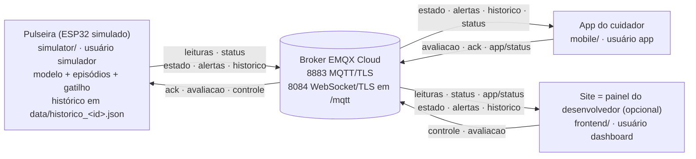

# MQTT: tópicos, mensagens e ACL

O Puzzle Band usa um broker MQTT na nuvem (**EMQX Cloud Serverless**,
`g12cbd17.ala.us-east-1.emqxsl.com`) para ligar as três partes:

- **Pulseira** (por enquanto o simulador do ESP32, `simulator/`): lê os
  sensores e **processa ali mesmo** (processamento na borda). Roda o modelo
  (Random Forest), a regra de gatilho e o histórico de episódios, e publica o
  resultado pronto. Também aplica no histórico o "Estou ciente" e a avaliação
  do cuidador.
- **App do cuidador** (`mobile/`): mostra o estado ao vivo, notifica os
  alertas, mostra o histórico e devolve à pulseira o "Estou ciente" e a
  avaliação do gatilho.
- **Site** (`frontend/`): é **opcional**. Serve de painel de visualização e
  controle para o desenvolvedor: mostra tudo o que a pulseira publica e,
  pelo "Controle da pulseira", envia os valores-alvo dos sensores simulados.
  Não roda o modelo e não publica estado, alertas nem histórico.



Em resumo: pulseira → broker → app, e o app devolve a avaliação e o "Estou
ciente" direto para a pulseira. O site só observa e manda comandos. **O app
funciona com o site fechado**; basta a pulseira estar ligada. O app nunca
recebe as leituras brutas e não roda o modelo.

## Por que o processamento fica na pulseira

Antes, o site era o "servidor": recebia as leituras, rodava o modelo e
publicava o resultado para o app. Com isso, o app só funcionava com o site
aberto em algum navegador. Agora o processamento fica na própria pulseira
(*edge computing*, processamento na borda):

- **Menos dependência de servidor.** A cadeia crítica é só pulseira → broker
  → app. Não há um computador ou aba de navegador que precise ficar aberto
  para o cuidador receber um alerta. Se a internet cair, a pulseira continua
  detectando e registrando os episódios no arquivo local e republica o
  histórico quando reconecta.
- **Menos dados transmitidos.** O app recebe só o resultado (estado 1×/s,
  alertas e histórico resumido), e não o sinal bruto de cada sensor. Na
  pulseira real, as leituras brutas poderiam nem sair do aparelho; aqui elas
  continuam sendo publicadas só para o painel do desenvolvedor desenhar os
  gráficos.
- **Alinhamento com a LGPD.** Sinais fisiológicos de uma criança são dados
  pessoais sensíveis (dados de saúde, art. 5º, II, e art. 11 da LGPD).
  Processar no próprio dispositivo segue os princípios da necessidade e da
  minimização (art. 6º, III): o que trafega é a indicação de apoio ao
  cuidador, e o histórico detalhado fica no aparelho.
- **Caminho para o hardware.** Na pulseira real, o mesmo processamento
  rodaria no ESP32. O Random Forest (60 árvores) teria de ser convertido para
  C, por exemplo com TinyML, ferramentas como micromlgen/emlearn ou árvores
  menores. Isso fica como **trabalho futuro**. No protótipo, o simulador em
  Node roda exatamente os mesmos módulos JavaScript que o site usava
  (`frontend/src/model/`), sem cópia de código.

## Tópicos

`<id>` é o código da criança (`CHILD_ID` / `VITE_CHILD_ID`, ex.: `C01`).

| Tópico | Publica | Assina | QoS | Retain | Por quê |
|---|---|---|---|---|---|
| `puzzleband/<id>/leituras` | pulseira, 1×/s | site (gráficos) | 0 | não | Chega uma por segundo: perder uma não faz falta. Leitura velha entregue depois só atrapalharia, então sem conexão a pulseira descarta. |
| `puzzleband/<id>/status` | pulseira: `online` ao conectar, `offline` ao sair ou como Last Will | site, app | 1 | sim | Quem conecta depois já sabe na hora se a pulseira está online. |
| `puzzleband/<id>/estado` | pulseira, 1×/s (a cada leitura) | app, site | 0 | sim | Cada mensagem substitui a anterior, então perder uma não importa. O retain entrega o último estado assim que o app conecta. O app confere o `timestamp` para não mostrar um estado velho como "ao vivo" (o site usa a mesma regra de 6 s). |
| `puzzleband/<id>/alertas` | pulseira, quando o nível **muda** para atenção ou possível crise | app, site | 1 | não | Alerta não pode se perder. QoS 1 é "pelo menos uma vez", e o app ignora repetidos pelo `episodio_id`. Sem retain, para um alerta antigo não disparar notificação em quem conecta depois. |
| `puzzleband/<id>/historico` | pulseira, quando um episódio abre, fecha ou é avaliado/visto, e a cada (re)conexão | app, site; a pulseira só na partida, sem arquivo local (recuperação) | 1 | sim | Leva a lista inteira (os 50 mais recentes), então repetir não causa problema. O retain dá a lista a quem abre depois. |
| `puzzleband/<id>/avaliacao` | app e site ("Confirmar gatilho" / "Descartar") | pulseira | 1 | não | Ação do cuidador não pode se perder. Sem retain, para não ser reaplicada a cada reconexão da pulseira. |
| `puzzleband/<id>/ack` | app ("Estou ciente") | pulseira | 1 | não | Mesmo motivo da avaliação. |
| `puzzleband/<id>/controle` | site ("Controle da pulseira") | pulseira, só no modo controle | 1 | não | Comando de desenvolvimento. Sem retain: a pulseira começa calma e o site reenvia os valores quando ela fica online. |
| `puzzleband/<id>/app/status` | app: `online` ao conectar (e a cada 60 s), `offline` ao sair ou como Last Will | site | 1 | sim | Indicador "App do cuidador: conectado/desconectado" no site. |

`status` e `app/status` são texto puro (`online` / `offline`). Os demais são
JSON em UTF-8.

## Formato das mensagens

Os campos com `null` aparecem sempre (o tipo não muda). As datas estão em ISO
8601 (UTC). O formato de `estado`, `alertas`, `historico`, `avaliacao` e
`ack` é o mesmo de quando o site era o servidor. O app não precisou de
nenhuma mudança. O único valor que mudou foi `origem`, que agora é
`"pulseira"`; o app não lê esse campo.

### `estado` (pulseira → app e site)

```json
{
  "origem": "pulseira",
  "timestamp": "2026-11-04T15:20:31.512Z",
  "fonte": "pulseira",
  "crianca": "C01",
  "nivel": "alto_risco",
  "probabilidade": 0.812,
  "leituras": {
    "timestamp": "2026-11-04T15:20:31.004Z",
    "bpm": 131, "eda_uS": 9.42, "hrv_ms": 21.3, "gyro_mag_dps": 6.1,
    "regularidade": 0.12, "luz_lux": 305, "ruido_db": 87.6
  },
  "media_bpm_5min": 97.4,
  "gatilho": { "tipo": "ruido", "texto": "Provável gatilho: ruído (45 → 88 dB, cerca de 12 s antes da alteração fisiológica)." },
  "episodio": { "id": "ep_1762269600000_120", "inicio": "2026-11-04T15:19:58.004Z", "nivel_maximo": "alto_risco", "visto_pelo_cuidador_em": null }
}
```

- `fonte`: `pulseira` (rodando um cenário) ou `manual` (modo controle,
  seguindo os valores do painel do site; o app mostra "Simulador manual").
- `nivel`: `baixo_risco`, `atencao` ou `alto_risco`. `probabilidade` é
  `null` nos primeiros 30 s (o modelo precisa de 31 leituras).
- `leituras`: a leitura mais recente (`null` se não há nenhuma).
- `media_bpm_5min`: média do BPM no buffer da pulseira (até 300 leituras, ou
  seja, 5 min de sinal a 1 Hz).
- `gatilho` e `episodio`: só com um episódio em andamento; fora disso, `null`.
  O gatilho vai resumido (`tipo` + `texto`).

### `alertas` (pulseira → app e site)

```json
{
  "origem": "pulseira",
  "timestamp": "2026-11-04T15:19:58.120Z",
  "fonte": "pulseira",
  "crianca": "C01",
  "episodio_id": "ep_1762269600000_120",
  "nivel_anterior": "baixo_risco",
  "nivel": "atencao",
  "probabilidade": 0.553,
  "gatilho": { "tipo": "ruido", "texto": "Provável gatilho: ...", "baseline_confiavel": true, "linha_de_base": {}, "fisiologia": {}, "sinais": {} },
  "leituras": { "timestamp": "...", "bpm": 112, "eda_uS": 7.1, "...": "..." }
}
```

Sai na mudança de nível **para** `atencao` ou `alto_risco` (de calmo para
atenção, de atenção para possível crise, e na volta de possível crise para
atenção). A volta ao calmo não gera alerta. O `gatilho` é o objeto completo de
`model/trigger.js` (ver [gatilho.md](gatilho.md)).

### `historico` (pulseira → app e site)

```json
{
  "origem": "pulseira",
  "timestamp": "2026-11-04T15:22:10.000Z",
  "crianca": "C01",
  "total": 7,
  "episodios": [
    {
      "id": "ep_1762269600000_120",
      "crianca": "C01",
      "fonte": "pulseira",
      "inicio": "2026-11-04T15:19:58.004Z",
      "fim": "2026-11-04T15:21:40.004Z",
      "duracao_s": 102,
      "encerramento": "normalizou",
      "nivel_maximo": "alto_risco",
      "probabilidade_maxima": 0.874,
      "gatilho": { "tipo": "ruido", "texto": "Provável gatilho: ..." },
      "avaliacao_cuidador": "confirmado",
      "observacao": "sirene da escola",
      "avaliacao_origem": "app",
      "avaliacao_em": "2026-11-04T15:22:09.000Z",
      "visto_pelo_cuidador_em": "2026-11-04T15:20:12.000Z"
    }
  ]
}
```

São os mesmos campos do histórico da pulseira ([historico.md](historico.md)),
com o gatilho resumido e sem `ultima_leitura`. `encerramento: null` quer dizer
que o episódio está em andamento. `total` é quantos episódios a pulseira
guarda (pode ser mais que os 50 enviados). O gatilho completo, com os sinais de
ruído e luz, fica só no arquivo da pulseira (`simulator/data/historico_<id>.json`).

### `avaliacao` (app e site → pulseira)

```json
{ "episodio_id": "ep_1762269600000_120", "avaliacao": "confirmado", "observacao": "sirene da escola", "origem": "app", "timestamp": "2026-11-04T15:22:09.000Z" }
```

- `avaliacao`: `confirmado` ou `descartado`. O site também pode mandar
  `pendente` para desfazer uma avaliação (clicar de novo no botão ativo). O
  app nunca manda `pendente`.
- `origem`: `app` ou `site` (sem o campo, vale `app`). Outras origens são
  descartadas.
- `observacao`: opcional, até 200 caracteres. O site manda a observação junto
  com a avaliação, como o app.

A pulseira aplica a avaliação no episódio (`avaliacao_cuidador`,
`avaliacao_origem`, `avaliacao_em`, `observacao`), grava o arquivo e republica
o `historico`. Se o episódio não existir, nada muda, mas o histórico é
republicado mesmo assim, para quem mandou se corrigir.

### `ack` (app → pulseira)

```json
{ "episodio_id": "ep_1762269600000_120", "timestamp": "2026-11-04T15:20:12.000Z", "origem": "app" }
```

A pulseira grava `visto_pelo_cuidador_em` no episódio e republica o
histórico. O `estado` seguinte já leva o horário em `episodio`, e o site
mostra "Alerta visto pelo cuidador às HH:MM" no banner de alerta e no
histórico.

### `controle` (site → pulseira, modo controle)

```json
{ "origem": "site", "timestamp": "2026-11-06T15:00:02.500Z", "bpm": 135, "eda": 9.5, "hrv": 25, "movimento": 5, "regularidade": 0.08, "luz": 300, "ruido": 88, "idade": 8 }
```

Valores-alvo dos sensores simulados. A pulseira só assina este tópico quando
roda com `npm run controle` (`--cenario controle`).

| Campo | Faixa | O que é |
|---|---|---|
| `bpm` | 50–190 | frequência cardíaca (bpm) |
| `eda` | 1–16 | atividade eletrodérmica (µS) |
| `hrv` | 10–90 | variabilidade cardíaca (ms) |
| `movimento` | 0–250 | intensidade-base do giroscópio (dps). O painel manda a base da ação escolhida: repouso 5, andando 45, brincando 110, correndo 180, agitado 250 |
| `regularidade` | 0–1 | regularidade do movimento (livre 0,08; repetitivo/estereotipia 0,8) |
| `luz` | 0–1000 | luminosidade (lux) |
| `ruido` | 20–100 | ruído ambiente (dB) |
| `idade` | 5–12, inteiro | idade da criança (anos) |

- Todos os campos são opcionais. Cada um é conferido sozinho: um valor fora
  da faixa, ou com o tipo errado, é ignorado, e os outros continuam valendo.
  JSON inválido é descartado. As faixas ficam em `CONTROL_LIMITS`
  (`frontend/src/model/simulate.js`), usadas pelo site e pela pulseira.
- **Transição suave.** Cada sinal vai do valor atual até o novo alvo numa
  rampa linear de 20 s (a mesma das rampas ambientais dos cenários). A idade
  muda na hora. As leituras saem do mesmo gerador do simulador
  (`generateReading`), com o mesmo ruído de sensor.
- **Sem comando, fica calmo** (bpm 78, EDA 4, HRV 55, repouso, movimento
  livre, 300 lux, 45 dB).
- **Frequência.** O site manda no máximo 2 mensagens por segundo, sempre com o
  último valor (`frontend/src/hooks/throttle.js`). Ele reenvia os valores
  atuais quando conecta ou quando a pulseira volta a ficar online.

### Validação

Todos validam o que recebem. JSON malformado, campo obrigatório ausente ou
valor fora da lista faz a mensagem ser descartada, sem quebrar a tela nem a
pulseira:

- pulseira e site: `frontend/src/hooks/parseMessages.js`;
- app: `mobile/lib/models/models.dart`.

Os testes ficam em `frontend/src/hooks/messages.test.js`,
`simulator/testes/` e `mobile/test/`.

## Como os laços são evitados

1. **Ninguém assina o que publica.** A pulseira não assina `estado` nem
   `alertas`. Ela só assina `historico` na partida, sem arquivo local, e
   cancela a assinatura assim que recebe a mensagem retida (ou depois de 5 s).
   O site não assina `controle` nem `avaliacao`. O app não assina
   `avaliacao`, `ack` nem `app/status`. Ninguém usa curingas (`+`, `#`) nas
   assinaturas.
2. **Um só dono por tópico.** Só a pulseira publica `estado`, `alertas` e
   `historico`. O site deixou de publicá-los.
3. **Origem nas mensagens.** A pulseira põe `"origem": "pulseira"` no que
   publica, o site põe `"site"` e o app põe `"app"`. A pulseira descarta
   `avaliacao` e `ack` com origem `pulseira`.
4. **Republicar o histórico não gera eco.** A pulseira só republica quando a
   "assinatura" do histórico muda (episódio abriu, fechou, mudou de nível, foi
   avaliado ou visto), e não a cada segundo de duração. Também republica a
   cada (re)conexão e depois de cada `ack`/`avaliacao`. Quem recebe o
   histórico não publica nada de volta.

## Histórico na pulseira

- **Arquivo local.** A pulseira grava o histórico em
  `simulator/data/historico_<id>.json`. A pasta fica fora do Git: são dados
  de saúde. A gravação é atômica e agrupada (no máximo uma a cada 2 s), e há
  uma gravação final ao encerrar.
- **Ao iniciar:**
  - Se o arquivo existir, a pulseira recupera dele.
  - Se não existir, assina `historico`, importa a mensagem retida (espera até
    5 s) e só então publica o seu histórico. Assim não apaga o retido com uma
    lista vazia.
  - Um episódio que estava "em andamento" quando a pulseira caiu vira
    "interrompido".
  - Um arquivo corrompido é guardado como `historico_<id>.corrompido-<data>.json`.
- **Ao encerrar (Ctrl+C):** fecha o episódio aberto como "interrompido",
  grava o arquivo e publica o histórico final.
- **Para começar do zero:** `npm start -- --limpar-historico`. Isso apaga a
  lista do arquivo e publica a lista vazia, também para o app.

## Conexões e Last Will

| Cliente | Transporte | Sessão | Keepalive | Last Will | Reconexão |
|---|---|---|---|---|---|
| Pulseira (`simulator/index.js` + `simulator/borda.js`) | `mqtts://…:8883` | limpa | 15 s | `status` = `offline` (retain) | a cada 3 s; continua processando offline e republica o histórico ao reconectar |
| Site (`frontend/src/hooks/useBandLink.js`) | `wss://…:8084/mqtt` | limpa | padrão do mqtt.js (60 s) | não tem | a cada 3 s; só publica conectado |
| App (`mobile/lib/services/mqtt_service.dart`) | `mqtts://…:8883` | limpa | 60 s | `app/status` = `offline` (retain, QoS 1) | automática; se a 1ª conexão falhar, tenta de novo em 2, 5, 10, 20 e 30 s |

- O broker publica o Last Will quando a conexão cai sem DISCONNECT: na hora,
  se o socket fecha (processo morto), ou após ~1,5 × keepalive sem resposta
  (~22 s na pulseira, ~90 s no app).
- O app usa um *client id* fixo por instalação. Assim, numa reconexão, o
  broker derruba a sessão antiga em vez de manter duas. O app também
  republica `online` a cada 60 s, o que corrige um `offline` atrasado de uma
  conexão antiga.
- Sessão limpa nos três: as assinaturas são refeitas a cada conexão. Os
  tópicos com retain (`estado`, `historico`, `status`, `app/status`) entregam
  o último valor logo após a assinatura.
- A pulseira só publica `estado` e `alertas` com o broker conectado: estado
  ou alerta velho entregue depois da reconexão seria enganoso. Os episódios
  detectados offline não se perdem, porque ficam no arquivo e vão no histórico
  republicado ao reconectar.

## ACL sugerida (menor privilégio)

Cada cliente tem um usuário próprio no EMQX Cloud (**Access Control →
Authentication**). Em **Access Control → Authorization**, crie regras por
usuário (*username*), liberando só o necessário e negando o resto. Exemplo
para a criança `C01`:

**`simulador`** (a pulseira)

| Permissão | Ação | Tópico |
|---|---|---|
| allow | publish | `puzzleband/C01/leituras` |
| allow | publish | `puzzleband/C01/status` |
| allow | publish | `puzzleband/C01/estado` |
| allow | publish | `puzzleband/C01/alertas` |
| allow | publish | `puzzleband/C01/historico` |
| allow | subscribe | `puzzleband/C01/ack` |
| allow | subscribe | `puzzleband/C01/avaliacao` |
| allow | subscribe | `puzzleband/C01/controle` |
| allow | subscribe | `puzzleband/C01/historico` (só para recuperar o histórico retido ao iniciar sem o arquivo local) |
| deny | publish e subscribe | `#` |

**`dashboard`** (o site, painel do desenvolvedor)

| Permissão | Ação | Tópico |
|---|---|---|
| allow | subscribe | `puzzleband/C01/leituras` |
| allow | subscribe | `puzzleband/C01/status` |
| allow | subscribe | `puzzleband/C01/app/status` |
| allow | subscribe | `puzzleband/C01/estado` |
| allow | subscribe | `puzzleband/C01/alertas` |
| allow | subscribe | `puzzleband/C01/historico` |
| allow | publish | `puzzleband/C01/controle` |
| allow | publish | `puzzleband/C01/avaliacao` |
| deny | publish e subscribe | `#` |

**`app`** (o celular do cuidador; não mudou)

| Permissão | Ação | Tópico |
|---|---|---|
| allow | subscribe | `puzzleband/C01/estado` |
| allow | subscribe | `puzzleband/C01/alertas` |
| allow | subscribe | `puzzleband/C01/historico` |
| allow | subscribe | `puzzleband/C01/status` |
| allow | publish | `puzzleband/C01/avaliacao` |
| allow | publish | `puzzleband/C01/ack` |
| allow | publish | `puzzleband/C01/app/status` |
| deny | publish e subscribe | `#` |

Observações:

- **O "deny `#`" tem que valer depois das regras de allow.** Coloque-o por
  último (ou com a menor prioridade) para cada usuário. Confira também o que o
  seu deployment faz quando nenhuma regra casa: o ideal é negar.
- **O Last Will precisa de permissão de publish** no tópico dele (`status`
  para a pulseira, `app/status` para o app). As tabelas acima já cobrem isso.
- **O que mudou com o processamento na borda.** O `simulador` passou a
  publicar `estado`, `alertas` e `historico` e a assinar `ack`, `avaliacao`,
  `controle` e `historico`. O `dashboard` perdeu o publish de `estado`,
  `alertas` e `historico`: agora só publica `controle` e `avaliacao`, e assina
  `estado`, `alertas` e `historico` para mostrar.
- **Por que isso importa aqui.** A senha do `dashboard` vai no JavaScript do
  navegador (variáveis `VITE_*`, ver abaixo) e a senha do `app` vai dentro do
  APK. As duas podem ser extraídas por quem tiver o site ou o APK. Com a ACL,
  uma credencial vazada só faz o que aquele papel já faz:
  - com a do app ou a do dashboard, ninguém consegue publicar leituras, um
    `estado`, um alerta ou um histórico falsos: só a pulseira publica esses
    tópicos;
  - o pior que a senha do `dashboard` permite é mandar valores de `controle`
    (que só valem com a pulseira no modo controle, de desenvolvimento) e
    avaliar episódios, o mesmo que o app já faz.

  Uma autenticação de verdade por dispositivo (certificado na pulseira, login
  no app) fica como trabalho futuro.
- **Mais de uma criança:** repita as regras por `<id>`, ou use
  `puzzleband/+/...` (menos restrito: dá acesso a todas as crianças).

## Variáveis `VITE_*` e a senha do dashboard

O Vite embute as variáveis `VITE_*` do `frontend/.env` no JavaScript
entregue ao navegador. Qualquer pessoa que abrir o site consegue ver
`VITE_MQTT_USER` e `VITE_MQTT_PASS` nas ferramentas do desenvolvedor. Para o
protótipo isso é aceitável se:

- o usuário `dashboard` tiver só as permissões da ACL acima;
- o site não for publicado na internet (rodar com `npm run dev` ou
  `npm run preview` no computador da demonstração);
- a senha for trocada depois da apresentação.

O `.env` nunca vai para o Git (`frontend/.gitignore`).

## Verificar pelo terminal (`verificar-app`)

`tools/verificar-app.mjs` faz o papel do app sem celular nem emulador. Ele
conecta com o usuário e a senha do `mobile/env.json` (a senha não é impressa)
e faz quatro coisas:

1. Assina `estado`, `alertas`, `historico` e `status` e mostra o que chega.
2. Confere cada campo com o que o código Dart espera e imprime OK ou FALHA por
   campo.
3. Publica um `ack` e uma `avaliacao` de teste, no mesmo formato do app.
4. Espera a pulseira republicar o `historico` com os dois aplicados.

```bash
cd simulator
npm install                                # uma vez (traz o pacote mqtt)
npm run crise-ruido -- --uma-vez           # num terminal: a pulseira (o site pode ficar fechado)
npm run verificar-app -- --tempo 300       # em outro: escuta até 5 min (a crise sai em ~2,5 min)
npm run verificar-app                      # escuta até 60 s
npm run verificar-app -- --sem-publicar    # só escuta
```

A pulseira precisa estar ligada, porque é ela que publica. O site não é
necessário.

O `ack` e a `avaliacao` de teste vão para:

- o episódio do alerta recebido;
- se não chegou alerta, o episódio mais recente do histórico;
- se o histórico está vazio, o id `teste-verificacao`, que a pulseira não
  conhece: nesse caso ela só republica o histórico.

O verificador não publica em `app/status`, para não mexer no indicador de um
app de verdade conectado ao mesmo tempo. Ele conecta com MQTT 5 (o app usa
3.1.1) só para o broker informar o motivo de uma recusa da ACL.

Termina com o código 0 se não houver FALHA e com 1 se houver.

## Teste manual com um cliente MQTT

Para depurar sem o celular, dá para usar um cliente como o MQTTX, conectado
com o usuário `app` (TLS, porta 8883):

- assine `puzzleband/C01/estado` para ver o estado chegando 1×/s (com a
  pulseira ligada);
- publique em `puzzleband/C01/ack` o JSON
  `{"episodio_id":"<id do episódio em andamento>","origem":"app"}`. A pulseira
  aplica, o próximo `estado` já traz `visto_pelo_cuidador_em` e o site (se
  estiver aberto) mostra "Alerta visto pelo cuidador às HH:MM".
- com a pulseira em `npm run controle`, publique em `puzzleband/C01/controle`
  (com o usuário `dashboard`) o JSON `{"bpm":135,"eda":9,"hrv":25}`: em ~20 s
  as leituras chegam nesses valores.
