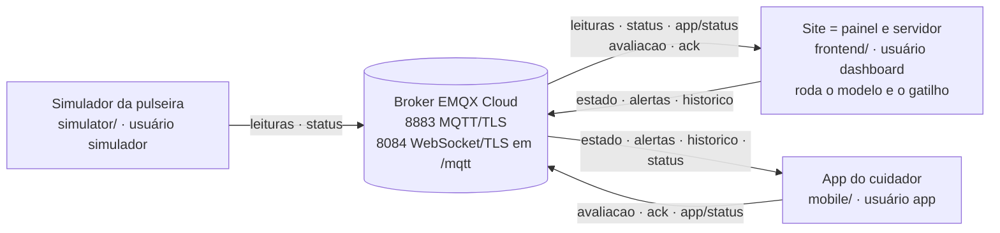

# MQTT: tópicos, mensagens e ACL

O Puzzle Band usa um broker MQTT na nuvem (**EMQX Cloud Serverless**,
`g12cbd17.ala.us-east-1.emqxsl.com`) para ligar as três partes:

- **Pulseira** (por enquanto o simulador, `simulator/`): publica as leituras
  dos sensores.
- **Site** (`frontend/`): é o painel de controle e o "servidor". Roda o
  modelo (Random Forest), a regra de gatilho e o histórico de episódios, e
  publica o resultado já processado.
- **App do cuidador** (`mobile/`): mostra o estado ao vivo, notifica os
  alertas, mostra o histórico e devolve ao site o "Estou ciente" e a
  avaliação do gatilho.



Em resumo: simulador → broker → site (servidor) ⇄ app. O app nunca recebe as
leituras brutas e não roda o modelo. Ele só vê o que o site já processou.

**Nos dois modos do site.** O site fica conectado ao broker tanto no
"Simulador manual" quanto em "Pulseira (MQTT)". No modo manual, as leituras
vêm dos controles deslizantes, e o estado, os alertas e o histórico vão para
o app do mesmo jeito: mexer nos controles aparece no celular. As leituras
publicadas pela pulseira só entram no modelo no modo Pulseira.

## Tópicos

`<id>` é o código da criança (`CHILD_ID` / `VITE_CHILD_ID`, ex.: `C01`).

| Tópico | Publica | Assina | QoS | Retain | Por quê |
|---|---|---|---|---|---|
| `puzzleband/<id>/leituras` | pulseira (simulador), 1×/s | site (só usa no modo Pulseira) | 0 | não | Chega uma por segundo: perder uma não faz falta, e leitura velha entregue depois atrapalharia o modelo (sem conexão, o simulador descarta). |
| `puzzleband/<id>/status` | pulseira: `online` ao conectar, `offline` ao sair ou como Last Will | site, app | 1 | sim | Quem conecta depois já sabe na hora se a pulseira está online. |
| `puzzleband/<id>/estado` | site, 1×/s | app | 0 | sim | Cada mensagem substitui a anterior, então perder uma não importa. O retain entrega o último estado assim que o app conecta. O app confere o `timestamp` para não mostrar um estado velho como "ao vivo". |
| `puzzleband/<id>/alertas` | site, quando o nível **muda** para atenção ou possível crise | app | 1 | não | Alerta não pode se perder. QoS 1 é "pelo menos uma vez", e o app ignora repetidos pelo `episodio_id`. Sem retain, para um alerta antigo não disparar notificação em quem conecta depois. |
| `puzzleband/<id>/historico` | site, quando um episódio abre, fecha ou é avaliado/visto, e a cada (re)conexão | app | 1 | sim | Leva a lista inteira (os 50 mais recentes), então repetir não causa problema. O retain dá a lista ao app assim que ele abre. |
| `puzzleband/<id>/avaliacao` | app ("Confirmar gatilho" / "Descartar") | site | 1 | não | Ação do cuidador não pode se perder. Sem retain, para não ser reaplicada a cada reconexão do site. |
| `puzzleband/<id>/ack` | app ("Estou ciente") | site | 1 | não | Mesmo motivo da avaliação. |
| `puzzleband/<id>/app/status` | app: `online` ao conectar (e a cada 60 s), `offline` ao sair ou como Last Will | site | 1 | sim | Indicador "App do cuidador: conectado/desconectado" no site. |

`status` e `app/status` são texto puro (`online` / `offline`). Os demais são
JSON em UTF-8.

## Formato das mensagens

Os campos com `null` aparecem sempre (o tipo não muda). As datas estão em ISO
8601 (UTC).

### `estado` (site → app)

```json
{
  "origem": "site",
  "timestamp": "2026-11-04T15:20:31.512Z",
  "fonte": "manual",
  "crianca": "C01",
  "nivel": "alto_risco",
  "probabilidade": 0.812,
  "leituras": {
    "timestamp": "2026-11-04T15:20:31.004Z",
    "bpm": 131, "eda_uS": 9.42, "hrv_ms": 21.3, "gyro_mag_dps": 6.1,
    "regularidade": 0.12, "luz_lux": 305, "ruido_db": 87.6
  },
  "media_bpm_5min": 97.4,
  "gatilho": { "tipo": "ruido", "texto": "Provável gatilho: ruído (45 → 88 dB, cerca de 12 s antes da alteração fisiológica)." },
  "episodio": { "id": "ep_1762269600000_120", "inicio": "2026-11-04T15:19:58.004Z", "nivel_maximo": "alto_risco", "visto_pelo_cuidador_em": null }
}
```

- `fonte`: `manual` (Simulador manual) ou `pulseira`.
- `nivel`: `baixo_risco`, `atencao` ou `alto_risco`. `probabilidade` é
  `null` nos primeiros 30 s (o modelo precisa de 31 leituras).
- `leituras`: a leitura mais recente (`null` se não há nenhuma).
- `media_bpm_5min`: média do BPM no buffer do site (até 300 leituras, ou seja,
  5 min de sinal a 1 Hz).
- `gatilho` e `episodio`: só com um episódio em andamento; fora disso, `null`.
  O gatilho vai resumido (`tipo` + `texto`).

### `alertas` (site → app)

```json
{
  "origem": "site",
  "timestamp": "2026-11-04T15:19:58.120Z",
  "fonte": "manual",
  "crianca": "C01",
  "episodio_id": "ep_1762269600000_120",
  "nivel_anterior": "baixo_risco",
  "nivel": "atencao",
  "probabilidade": 0.553,
  "gatilho": { "tipo": "ruido", "texto": "Provável gatilho: ...", "baseline_confiavel": true, "linha_de_base": {}, "fisiologia": {}, "sinais": {} },
  "leituras": { "timestamp": "...", "bpm": 112, "eda_uS": 7.1, "...": "..." }
}
```

Sai na mudança de nível **para** `atencao` ou `alto_risco` (de calmo para
atenção, de atenção para possível crise, e na volta de possível crise para
atenção). A volta ao calmo não gera alerta. O `gatilho` é o objeto completo de
`model/trigger.js` (ver [gatilho.md](gatilho.md)).

### `historico` (site → app)

```json
{
  "origem": "site",
  "timestamp": "2026-11-04T15:22:10.000Z",
  "crianca": "C01",
  "total": 7,
  "episodios": [
    {
      "id": "ep_1762269600000_120",
      "crianca": "simulada",
      "fonte": "manual",
      "inicio": "2026-11-04T15:19:58.004Z",
      "fim": "2026-11-04T15:21:40.004Z",
      "duracao_s": 102,
      "encerramento": "normalizou",
      "nivel_maximo": "alto_risco",
      "probabilidade_maxima": 0.874,
      "gatilho": { "tipo": "ruido", "texto": "Provável gatilho: ..." },
      "avaliacao_cuidador": "confirmado",
      "observacao": "sirene da escola",
      "avaliacao_origem": "app",
      "avaliacao_em": "2026-11-04T15:22:09.000Z",
      "visto_pelo_cuidador_em": "2026-11-04T15:20:12.000Z"
    }
  ]
}
```

Os mesmos campos do histórico do site ([historico.md](historico.md)), com o
gatilho resumido e sem `ultima_leitura`. `encerramento: null` = em andamento.
`total` é quantos episódios o site tem (pode ser mais que os 50 enviados).

### `avaliacao` (app → site)

```json
{ "episodio_id": "ep_1762269600000_120", "avaliacao": "confirmado", "observacao": "sirene da escola", "origem": "app", "timestamp": "2026-11-04T15:22:09.000Z" }
```

`avaliacao`: `confirmado` ou `descartado`. `observacao` é opcional (até 200
caracteres). O site aplica com a mesma função dos botões do histórico, marca o
episódio como "avaliado pelo app" e republica o `historico`.

### `ack` (app → site)

```json
{ "episodio_id": "ep_1762269600000_120", "timestamp": "2026-11-04T15:20:12.000Z", "origem": "app" }
```

O site grava `visto_pelo_cuidador_em` no episódio e mostra "Alerta visto pelo
cuidador às HH:MM" no banner de alerta e no histórico.

### Validação

Os dois lados validam tudo o que recebem. JSON malformado, campo obrigatório
ausente ou valor fora da lista faz a mensagem ser descartada sem quebrar a
tela (site: `frontend/src/hooks/parseMessages.js`; app:
`mobile/lib/models/models.dart`). No site, os testes ficam em
`frontend/src/hooks/messages.test.js`. No app, em `mobile/test/`.

## Como os laços são evitados

1. **Ninguém assina o que publica.** O site não assina `estado`, `alertas`
   nem `historico`. O app não assina `avaliacao`, `ack` nem `app/status`.
   Nenhum dos dois usa curingas (`+`, `#`) nas assinaturas.
2. **Origem nas mensagens.** Tudo o que o site publica leva
   `"origem": "site"`, e o que o app publica leva `"origem": "app"`. O site
   descarta `avaliacao` e `ack` com origem `site`.
3. **Republicar o histórico não gera eco.** O site só republica quando a
   "assinatura" do histórico muda (episódio abriu, fechou, mudou de nível,
   foi avaliado ou visto), e não a cada segundo de duração. O app, ao receber
   o histórico, não publica nada de volta.

## Conexões e Last Will

| Cliente | Transporte | Sessão | Keepalive | Last Will | Reconexão |
|---|---|---|---|---|---|
| Simulador (`simulator/index.js`) | `mqtts://…:8883` | limpa | 15 s | `status` = `offline` (retain) | a cada 3 s |
| Site (`frontend/src/hooks/useMqttReadings.js`) | `wss://…:8084/mqtt` | limpa | padrão do mqtt.js (60 s) | não tem | a cada 3 s; só publica conectado |
| App (`mobile/lib/services/mqtt_service.dart`) | `mqtts://…:8883` | limpa | 60 s | `app/status` = `offline` (retain, QoS 1) | automática; se a 1ª conexão falhar, tenta de novo em 2, 5, 10, 20 e 30 s |

- O broker publica o Last Will quando a conexão cai sem DISCONNECT: na hora,
  se o socket fecha (processo morto), ou após ~1,5 × keepalive sem resposta
  (~90 s no app).
- O app usa um *client id* fixo por instalação. Assim, numa reconexão, o
  broker derruba a sessão antiga em vez de manter duas. O app também
  republica `online` a cada 60 s, o que corrige um `offline` atrasado de uma
  conexão antiga.
- Sessão limpa nos três: as assinaturas são refeitas a cada conexão. Os
  tópicos com retain (`estado`, `historico`, `status`, `app/status`) entregam
  o último valor logo após a assinatura.

## ACL sugerida (menor privilégio)

Cada cliente tem um usuário próprio no EMQX Cloud (**Access Control →
Authentication**). Em **Access Control → Authorization**, crie regras por
usuário (*username*), liberando só o necessário e negando o resto. Exemplo
para a criança `C01`:

**`simulador`** (a pulseira)

| Permissão | Ação | Tópico |
|---|---|---|
| allow | publish | `puzzleband/C01/leituras` |
| allow | publish | `puzzleband/C01/status` |
| deny | publish e subscribe | `#` |

**`dashboard`** (o site)

| Permissão | Ação | Tópico |
|---|---|---|
| allow | subscribe | `puzzleband/C01/leituras` |
| allow | subscribe | `puzzleband/C01/status` |
| allow | subscribe | `puzzleband/C01/app/status` |
| allow | subscribe | `puzzleband/C01/avaliacao` |
| allow | subscribe | `puzzleband/C01/ack` |
| allow | publish | `puzzleband/C01/estado` |
| allow | publish | `puzzleband/C01/alertas` |
| allow | publish | `puzzleband/C01/historico` |
| deny | publish e subscribe | `#` |

**`app`** (o celular do cuidador)

| Permissão | Ação | Tópico |
|---|---|---|
| allow | subscribe | `puzzleband/C01/estado` |
| allow | subscribe | `puzzleband/C01/alertas` |
| allow | subscribe | `puzzleband/C01/historico` |
| allow | subscribe | `puzzleband/C01/status` |
| allow | publish | `puzzleband/C01/avaliacao` |
| allow | publish | `puzzleband/C01/ack` |
| allow | publish | `puzzleband/C01/app/status` |
| deny | publish e subscribe | `#` |

Observações:

- **O "deny `#`" tem que valer depois das regras de allow.** Coloque-o por
  último (ou com a menor prioridade) para cada usuário. Confira também o que o
  seu deployment faz quando nenhuma regra casa: o ideal é negar.
- **O Last Will precisa de permissão de publish** no tópico dele (`status`
  para o simulador, `app/status` para o app). As tabelas acima já cobrem isso.
- **Por que isso importa aqui.** A senha do `dashboard` vai no JavaScript do
  navegador (variáveis `VITE_*`, ver abaixo) e a senha do `app` vai dentro do
  APK. As duas podem ser extraídas por quem tiver o site ou o APK. Com a ACL,
  uma credencial vazada só faz o que aquele papel já faz. Com a do app, por
  exemplo, ninguém consegue publicar leituras falsas nem um `estado` falso. A
  ACL não impede que quem tem a senha do `dashboard` publique um alerta
  falso. Para isso seria preciso um backend com autenticação de verdade
  (trabalho futuro).
- **Mais de uma criança:** repita as regras por `<id>`, ou use
  `puzzleband/+/...` (menos restrito: dá acesso a todas as crianças).

## Variáveis `VITE_*` e a senha do dashboard

O Vite embute as variáveis `VITE_*` do `frontend/.env` no JavaScript
entregue ao navegador. Qualquer pessoa que abrir o site consegue ver
`VITE_MQTT_USER` e `VITE_MQTT_PASS` nas ferramentas do desenvolvedor. Para o
protótipo isso é aceitável se:

- o usuário `dashboard` tiver só as permissões da ACL acima;
- o site não for publicado na internet (rodar com `npm run dev` ou
  `npm run preview` no computador da demonstração);
- a senha for trocada depois da apresentação.

O `.env` nunca vai para o Git (`frontend/.gitignore`).

## Verificar pelo terminal (`verificar-app`)

`tools/verificar-app.mjs` faz o papel do app sem celular nem emulador. Ele
conecta com o usuário e a senha do `mobile/env.json` (a senha não é impressa)
e faz quatro coisas:

1. Assina `estado`, `alertas`, `historico` e `status` e mostra o que chega.
2. Confere cada campo com o que o código Dart espera e imprime OK ou FALHA por
   campo.
3. Publica um `ack` e uma `avaliacao` de teste, no mesmo formato do app.
4. Espera o site republicar o `historico` com os dois aplicados.

```bash
cd simulator
npm install                                # uma vez (traz o pacote mqtt)
npm run verificar-app                      # escuta até 60 s
npm run verificar-app -- --tempo 300       # até 5 min (para provocar uma crise no site)
npm run verificar-app -- --sem-publicar    # só escuta
```

O site precisa estar aberto no navegador, porque é ele que publica.

O `ack` e a `avaliacao` de teste vão para:

- o episódio do alerta recebido;
- se não chegou alerta, o episódio mais recente do histórico;
- se o histórico está vazio, o id `teste-verificacao`, que o site não
  conhece: nesse caso ele só republica o histórico.

O verificador não publica em `app/status`, para não mexer no indicador de um
app de verdade conectado ao mesmo tempo. Ele conecta com MQTT 5 (o app usa
3.1.1) só para o broker informar o motivo de uma recusa da ACL.

Termina com o código 0 se não houver FALHA e com 1 se houver.

## Teste manual com um cliente MQTT

Para depurar sem o celular, dá para usar um cliente como o MQTTX, conectado
com o usuário `app` (TLS, porta 8883):

- assine `puzzleband/C01/estado` para ver o estado chegando 1×/s;
- publique em `puzzleband/C01/ack` o JSON
  `{"episodio_id":"<id do episódio em andamento>","origem":"app"}`. O site
  mostra "Alerta visto pelo cuidador às HH:MM".
